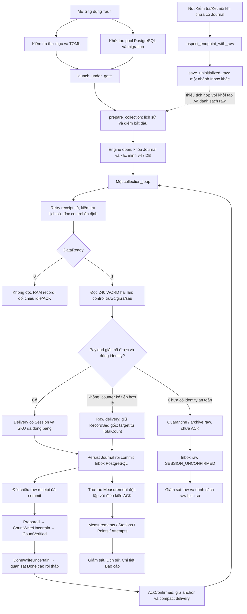

# Golf Report — Phân tích kiến trúc từ source để review độc lập

Ngày khảo sát: **17/11/2026, giờ Việt Nam**. Đây là tài liệu phân tích, **không phải lệnh refactor**. Chỉ tạo tài liệu này; không chạy ứng dụng, test, build, migration, Simulator hoặc kết nối PLC/PostgreSQL.

## Cách đọc và phạm vi bằng chứng

- **FACT**: thấy trực tiếp trong source/config/ô Excel tại thời điểm khảo sát. FACT về code không đồng nghĩa hành vi đã được nghiệm thu trên PLC.
- **INFERENCE**: suy luận từ các nhánh code; chưa tái hiện bằng chạy chương trình.
- **UNKNOWN**: thiếu Ladder, trace mạng, dữ liệu runtime hoặc kết quả kiểm thử để xác nhận.
- Số dòng tham chiếu là số dòng của working tree hiện tại, gồm các thay đổi chưa commit. Không dùng lịch sử hội thoại thay cho source. Thông tin lỗi người dùng cung cấp được phân tích theo code, không coi là log runtime đã thu thập độc lập.
- Khảo sát **73 file production/migration: 43 Rust, 2 SQL, 28 TypeScript/TSX/CSS**. Đọc thêm 8 file cấu hình/tài liệu công nghệ và 1 workbook, tổng **82 file**. Danh mục ở phụ lục. Không review sâu test, dependency, `target`, `dist`, `node_modules`, installer hoặc nhiều laptop.
- Không đưa connection string, mật khẩu hoặc nội dung bí mật DB vào tài liệu. Chỉ đọc cấu trúc cấu hình DB và cơ chế sử dụng.

## A. Tổng quan dự án

### A.1 Công nghệ và ranh giới trách nhiệm

**FACT** — `src-tauri/Cargo.toml`, `package.json`: Tauri 2, Rust edition 2024, Tokio, `tokio-modbus` 0.17, SQLx PostgreSQL, Chrono, BigDecimal; frontend React 19, TypeScript, Ant Design, Recharts; xuất Excel/CSV qua ExcelJS/XLSX và Tauri filesystem/dialog.

| Thành phần | Trách nhiệm thực tế | Điểm vào |
|---|---|---|
| Khởi động | Tạo DatabaseState/WorkerState, chuẩn bị thư mục/config, migrate DB rồi launch Worker | `src-tauri/src/lib.rs:132`, `run` |
| Cấu hình PLC | Parse TOML, kiểm tra map, quyền ghi, môi trường; không chọn nhiều PLC qua UI | `plc/simulator_config.rs:31`, `SimulatorConfig`; `plc/connection_settings.rs` |
| Transport/Reader | TCP có IP nguồn tùy chọn, FC03, snapshot ổn định | `plc/as200/mod.rs:41`, `connect_tcp`; `reader.rs:229`, `poll_published_record` |
| Decoder | Kiểu dữ liệu, cấu trúc record, kết quả/lượt đo | `plc/as200/decode.rs`; `model.rs:89`, `PlcStickRecord` |
| Acquisition | Một collection task; phối hợp Journal, Inbox, raw/measurement và ACK | `plc/worker.rs:670`, `collection_loop`; các file `worker/` |
| Dữ liệu bền vững | Inbox giữ raw; measurement chuẩn hóa phục vụ lịch sử/báo cáo | `services/inbox_service.rs`; `repositories/` |
| UI | Bốn trang, trạng thái chung, truy vấn read-only, thao tác kết nối/SKU | `src/App.tsx:36`; `src/layouts/MainLayout.tsx:23` |
| Công cụ kỹ thuật | FC03 đọc WORD độc lập; công cụ BOOL/WORD đọc/ghi có policy riêng | `connection_settings.rs:99`; `register_access.rs:310,325` |

Các đường dẫn Rust viết tắt `plc/...`, `services/...`, `repositories/...` trong tài liệu đều nằm dưới `src-tauri/src/`.

### A.2 Cấu hình thực tế đang nằm trong workspace

**FACT** — `as200_config.toml`: endpoint `192.168.1.49:502`, Unit ID 1, IP nguồn `192.168.1.100`, offset 0, LOW, control D25000, record 240 WORD, buffer_count 2, poll 500 ms, timeout 2000 ms, heartbeat timeout 5000 ms. `enabled=true`, `read_only=false`, `ack_enabled=true`, `technical_setup_confirmed=true`, `allow_plc_connection=true`, protocol `as200`; không ghi PC_Heartbeat. SourceKey `golf-report-plc-01`, Session `golf-report-plc-01-initial`, Journal `local-runtime/capture.json`, SKU `GOLD-X1`.

Đó là **giá trị file**, không phải chứng minh process đang chạy đã nạp file này hay PLC đã chấp nhận quyền ACK. `WorkerState::require_startup_environment` (`worker.rs:259`) so sánh với config lúc khởi động, có thể yêu cầu restart khi sửa môi trường/quyền. `SimulatorConfig::load` (`simulator_config.rs:337`) có log đường dẫn thực nạp.

**FACT** — `plc-register-access.toml` hiện `ui_enabled=false`; công cụ ghi kỹ thuật bị khóa. Profile demo cũ vẫn trỏ `192.168.1.5:502`, không phải endpoint `.49` hiện tại. Không dùng profile đó làm bằng chứng cấp ACK cho Worker.

**FACT** — `database/config.rs:20` đọc file DB bên ngoài binary; file thực tế dùng trường `connection_string`. Chưa truy cập DB để xác minh schema/data đã triển khai.

## B. Kiến trúc thực tế

**FACT** — Có một task acquisition (`worker.rs:852`), không có task điều phối hai buffer. Tuy nhiên một task không đồng nghĩa một TCP socket tồn tại xuyên suốt: mỗi `read_snapshot` tạo reader mới; các lần ghi Count/Done và đọc lại có socket riêng. DB, Journal và PLC là ba miền trạng thái, không có transaction chung (`worker.rs:483`; `as200/ack.rs:170–218`; `worker/journal.rs:323`).

## C. Luồng kết nối và thu nhận PLC

### C.1 Từ mở ứng dụng đến Worker

| Bước | File / hàm | Dữ liệu, kiểm tra và bước tiếp | Có thể chặn bởi |
|---|---|---|---|
| 1 | `lib.rs:132`, `run` | Manage state; `application_directory` → kiểm tra quyền ghi → `ensure_config`; initialize DB trước launch | File/đường dẫn không ghi được; thiếu config trong khi còn lịch sử; DB/migration lỗi |
| 2 | `connection_settings.rs:223`, `ensure_config` | Chỉ tạo template khi chưa có dấu vết runtime; không tự thay Session/Journal cũ | Dấu vết runtime/legacy chưa đối chiếu |
| 3 | `simulator_config.rs:337,358`, `load/parse` | Parse rõ kiểu, deny unknown fields, trả config và journal path | TOML sai; trường kỹ thuật/SKU/heartbeat thiếu; giới hạn poll/retry/map |
| 4 | `worker.rs:716`, `launch_under_gate` | Lưu startup environment; reset monitor heartbeat; kiểm tra operator-stop, enabled, SKU, scope ACK | Marker dừng; thiếu SKU trừ phục hồi delivery cũ; quyền chưa cấp; config khác lúc mở app |
| 5 | `connection_settings.rs:344`, `prepare_collection` | Nếu Journal tồn tại thì để Engine đối chiếu sau. Nếu thiếu, xét legacy/runtime/PG history rồi `read_new_baseline` | Bất kỳ source row hoặc Inbox/Measurement cũ khi thiếu Journal; counter/Done ban đầu không an toàn |
| 6 | `worker/journal.rs:236,300`, `Engine::open/verify_open` | Validate config; lock file; load v4 hoặc tạo progress accepted=0; verify receipt/prefix DB; persist Journal | Sai version/binding/session; lock bị giữ; thiếu receipt; lịch sử DB không đủ; pending ACK khi chuyển read-only |
| 7 | `worker.rs:670`, `collection_loop` | Lấy pool rồi `poll_and_ack_published`; sleep poll interval; Notify hỗ trợ reconnect | Không có pool; timeout bao ngoài; auto_reconnect=false khi disconnected; stopping |

`simulator_config.rs:313`, `locate` ưu tiên duy nhất thư mục ứng dụng được truyền vào. Helper development không có app_directory mới có fallback cwd/project. Dev dùng root project, Release dùng thư mục EXE (`lib.rs:12`). Đây là mô tả chọn file phục vụ acquisition, không phải review installer.

### C.2 Ba thao tác UI không có cùng tác dụng

1. **Kiểm tra kết nối** — `test_plc_connection` (`connection_settings.rs:492`) gọi `inspect_endpoint_with_raw`. Mở TCP một lần để kiểm tra reachability, sau đó reader mở kết nối FC03 khác. Không tạo Worker/ACK, nhưng **có thể ghi PostgreSQL nếu chưa có Journal và DataReady=1**. Vì vậy phát biểu “nút Kiểm tra hoàn toàn không ghi DB” trong README hiện không còn đúng.
2. **Kết nối** — `connect_plc_collection` (`:505`) chạy inspection; nếu inspection đã thử lưu raw thì trả lỗi ở `:525`, không vào `launch_under_gate`. Nếu vượt qua, yêu cầu SKU, đặt enabled, gỡ operator-stop rồi launch. `as200_valid=true` chỉ là cấu trúc control/snapshot trong lần probe, không tự chứng minh Session/ACK an toàn.
3. **Ngắt kết nối** — `stop_collection` (`worker.rs:316`) ghi marker bền vững, đặt stopping, join task, đóng waiter reconnect, thử flush tối đa 8 giây, giữ Journal, ghi log MANUAL_STOP. Không gửi ACK để “dọn hàng chờ”; không đổi Session/counter.

### C.3 Một vòng thu nhận

**FACT** — `poll_and_ack_published` (`worker.rs:570`): khóa `published_gate` → `persist_receipts` → `verify_published_history` → retry raw archive cũ → `read_snapshot` → kiểm tra phục hồi pause rất hẹp → xử lý read-only hoặc `published_ack_step` → retry/tạo measurement. Lỗi xử lý measurement được giữ riêng, không bắt buộc thành công trước ACK.

**FACT** — `As200Reader::poll_published_record` (`as200/reader.rs:229`):

- Đọc control trước. Nếu DataReady=0, đọc control lần hai; ổn định thì trả `buffer=None`, không đòi vùng dữ liệu cũ phải bằng 0.
- Nếu DataReady=1, đọc 240 WORD từ `control_start+20`, control giữa, 240 WORD lần hai, control sau; raw và các trường control chọn để so sánh phải ổn định. Heartbeat được phép thay đổi độc lập.
- FC03 chia tối đa 100 WORD/request (`map.rs:10`, `reader.rs:151`). Với map hiện tại một snapshot ready dùng 6 request raw và 3 control, tổng **9 FC03**, không phải một request 240 WORD. Idle dùng 2 FC03.
- Sau khi nhận raw mới thử decode. Raw toàn 0 hoặc thiếu Status bit0 có diagnostic; raw vẫn được giữ trong BufferSnapshot.
- Không dùng LastIdx/WriteIdx để chọn địa chỉ. `same_buffer_state` vẫn đưa các index vào tiêu chí ổn định (`model.rs`, `PlcControl::same_buffer_state`).

**INFERENCE** — Các lần reread trước Count/Done làm một record cần nhiều snapshot/poll. Đây là chi phí an toàn và có thể tăng độ trễ; chưa đo hiệu năng. Không thể kết luận cần bỏ kiểm tra ổn định chỉ từ số lượng request.

## D. Luồng lưu PostgreSQL

### D.1 Schema thực tế

**FACT** — Toàn bộ migration trong workspace chỉ có hai file SQL:

| Bảng / đối tượng | Dữ liệu / vai trò | Source |
|---|---|---|
| `plc_sources` | SourceKey duy nhất, ID để liên kết lịch sử; không chứa trạng thái ACK | `20261109120000_initialize_as200.sql:2` |
| `plc_inbox` | 240 WORD JSONB, word order, raw RecordSeq, total, receipt/key, thời gian, trạng thái xử lý, measurement link | Cùng file `:65` |
| `measurements` | SKU được gán, số gậy, Session/sequence, kết quả Overall, thời gian nhận | `:8` |
| `measurement_stations` | TIP/BUTT, Result, PointCount, NGPoint, Load | `:26` |
| `measurement_points` | PointNumber, Result, AttemptCount, DecideAttempt, Position nullable | `:37` |
| `measurement_attempts` | Các lượt đã thực hiện; PushDist/Bend nullable | `:47` |
| `plc_source_registry` | Hồ sơ nhiều nguồn/physical identity cũ; không được Worker dùng để cấp quyền | `20261111120000_plc_source_registry.sql:4` |
| `_sqlx_migrations` | Lịch sử migration do SQLx quản lý | `database/migrations.rs:5,27` |

`as200_valid_registers` (`migration đầu:55`) chấp nhận đúng 240 số nguyên 0–65535, **không cấm toàn 0**. Các numeric measurement không chấp nhận NaN/Infinity; 0 và số âm không bị cấm chung. **Không có bảng checkpoint/ACK intent** trong hai migration.

### D.2 Hai transaction khác nhau

1. `InboxService::receive` (`services/inbox_service.rs:168`): validate kích thước/key → begin → `InboxRepository::receive` → commit → trả row. `SourceRepository::lock` khóa source trong transaction; source upsert riêng diễn ra trước. ACK chỉ được xét sau read-back đối chiếu receipt này.
2. `InboxService::process_transaction` (`:243`): begin → lock Inbox → `draft_from_inbox` → validate workflow → insert Measurement/stations/points/attempts → đánh dấu Inbox PROCESSED → commit. Thất bại thì rollback; có thể đánh dấu FAILED và retry cùng Inbox ID (`:251`). Không tạo lại measurement đã có link.

**FACT** — `worker/delivery.rs:135`, `persist_receipts` thực hiện transaction raw thứ nhất; `process_pending_using` (`:278`) thực hiện/thử transaction measurement thứ hai. ACK hiện không bắt buộc transaction thứ hai thành công. Đây là khác biệt quan trọng so với chú thích README còn nói “receipt PROCESSED trước Count”.

### D.3 Idempotency, NULL và ý nghĩa trạng thái

- Unique `(source_id, ingest_key)` cho mọi Inbox; unique `(source_id, session_id, record_seq)` khi session khác NULL. Measurement cũng có unique source/session/sequence (`migration đầu:21,81,87`). StickNo không phải khóa chống trùng.
- `InboxRepository::receive` (`repositories/inbox_repository.rs:54`) kiểm tra key/session có trỏ tới hai row khác nhau không, raw/word order/metadata bất biến có khớp không; không ghi đè payload gốc.
- Record giải mã được dùng `published-sku-v1:<SKU hex>:<nonce>:<sequence>` (`inbox_service.rs:35`); SKU đóng băng trong key, measurement dùng SKU đó thay ProductCode PLC (`:154`).
- Raw ACK được dùng `raw-published-v1:ack:<độ dài Session>:<Session>:<TotalCount>` (`inbox_service.rs:20`; `worker/capture.rs:14`). `session_id` SQL là NULL để RecordSeq gốc=0 không đụng unique sequence; ngữ cảnh Session nằm trong key và Journal. **Không sửa raw RecordSeq thành TotalCount**.
- **RAW_UNDECODED không phải trạng thái SQL hiện hành**. SQL chỉ cho PENDING, FAILED, PROCESSED, SESSION_UNCONFIRMED (`migration đầu:77–85`). Raw session NULL lưu SESSION_UNCONFIRMED (`InboxRepository::receive`); RAW_UNDECODED được dùng ở WorkerStatus và marker quarantine. Một số code vẫn chấp nhận tên RAW_UNDECODED để tương thích nhánh cũ; đó không phải migration tạo trạng thái mới.
- `station()` (`inbox_service.rs:75`) chỉ lưu attempt đã đo; vị trí điểm chưa đo là NULL, không tự biến thành 0. TIP chỉ tạo P1, BUTT P1–P4 theo workflow code. SKIPPED được trình bày từ trạng thái chưa đo sau điểm NG; DB enum không có SKIPPED.

### D.4 Có lưu trùng dữ liệu không?

**FACT** — Cùng một bản ghi có thể hiện diện ở raw Journal, JSONB Inbox và các bảng measurement chuẩn hóa. Đây là bản gốc để recovery và projection cho báo cáo, không phải ba measurement sản xuất. Confirmed receipt anchor trong Journal tiếp tục giữ raw sau compaction (`worker/journal.rs:86`).

**INFERENCE** — Ba đường raw khác key có thể lưu cùng snapshot nhiều lần: raw khi inspection chưa có Journal; raw quarantine; raw ACK delivery. Unique constraint chỉ chống trùng trong từng identity/key, không tự gộp ba đường. Cần xem đường gọi và key trước khi gọi mọi bản sao là lỗi duplicate.

### D.5 Các query phục vụ UI

- `MeasurementRepository::list/statistics/sku_summary` (`measurement_repository.rs:839,937,608`) đọc **measurements**, áp cùng filter thời gian/SKU/số gậy/kết quả; có transaction REPEATABLE READ READ ONLY.
- `history_page` (`:653`) lấy trang list, rồi **một query batch** decision Bend cho các measurement ID trên trang. NULL giữ NULL; không tải chi tiết N request cho N gậy.
- `find_by_id` (`:821`) load stations/points/attempts qua repository con, có một số query theo cây. Với một measurement hiện tối đa 5 điểm nghiệp vụ, đây là số query nhỏ; không đánh đồng với N+1 tải toàn lịch sử.
- `report` (`:884`) dùng snapshot và query batch bốn cấp; không phân trang khi xuất toàn bộ kết quả theo filter. Phạm vi lớn có thể tốn RAM, chưa benchmark.
- `quality_statistics` (`:687`) dùng một CTE SQL: chỉ điểm đã đo có Result OK/NG, chỉ attempt tại DecideAttempt; đếm NG bằng DISTINCT measurement ID ở từng nhóm; histogram BUTT gộp P1–P4; không dùng PushDist thay Bend.
- `get_plc_raw_snapshots` (`commands/measurement_command.rs:118`) gọi `InboxRepository::raw_snapshots` (`inbox_repository.rs:94`): mặc định 20 row, clamp 1–100, không filter SKU/time/source. Chỉ gồm prefix `raw-published-v1`, `raw-zero-test-v1`, `raw-invalid-v1` — **không gồm `raw-uninitialized-v1`**.

## E. Luồng ACK

### E.1 ACK xác nhận điều gì trong source hiện tại?

**FACT** — `worker/recovery.rs:4`, hàm vẫn tên `processed_receipt` nhưng thực tế đã kiểm tra **raw receipt đã commit**:

- SourceKey và toàn bộ input bất biến phải khớp DB: Session, key, raw RecordSeq, total, buffer, word order, timestamp ở precision microsecond và 240 WORD.
- Raw publication phải có key đúng Session + counter, target>0, session SQL NULL, SESSION_UNCONFIRMED, chưa có measurement/process timestamp.
- Delivery thông thường có thể PENDING hoặc FAILED mà vẫn đủ bằng chứng raw. Nếu đã PROCESSED thì kiểm tra thêm link measurement cùng source/session/sequence.

Do đó ACK hiện đã tách khỏi đánh giá chất lượng, nhưng tên hàm, một số thông báo và chú thích vẫn còn ngữ nghĩa cũ. **INFERENCE** — Đây là nguồn gây hiểu nhầm khi vận hành/review; không phải bằng chứng ACK trước commit.

### E.2 Các điều kiện trước khi tạo intent

`Engine::published_ack_step` (`worker/ack.rs:85`) và các hàm được gọi yêu cầu:

1. Quyền cấu hình: không read-only, ack_enabled, scope AS200 cho LOW/offset 0/control 25000/layout hiện hành; `Engine::open` còn yêu cầu allow_plc_connection, Session và cấm PC heartbeat write (`worker/journal.rs:236`; `simulator_config.rs:15`). Cờ compile-time scope APPROVED=true **không phải chứng cứ Ladder tại endpoint**.
2. Journal v4 đúng binding/source/session, không pause; total không giảm so với accepted hoặc last_total; các control đúng layout, count hợp lệ, Done/Ready là 0/1.
3. Nếu chưa có pending intent: PC_ReadCount=accepted, PC_ReadDone=0. DataReady=0 không tạo record; counter phải khớp idle lịch sử. DataReady=1 mới tiếp nhận vùng raw.
4. Payload decode được, SKU có và raw RecordSeq=TotalCount: đi `published_delivery` (`capture.rs:257`), giữ các validation measurement và sequence liên tiếp.
5. Payload không đủ điều kiện decode/identity: `capture_counter_raw` (`capture.rs:14`) chỉ cho tạo raw ACK delivery khi **TotalCount=accepted+1**, count=accepted, Done=0, Ready=1, raw 240 WORD ổn định, không có delivery khác bỏ qua. Target là counter thật; RecordSeq gốc vẫn nguyên trạng.
6. Nếu chưa có counter mới: `capture_invalid_snapshot` (`capture.rs:67`) lưu archive raw nhưng chưa tạo ACK intent. Tổng bằng 0 không tự được coi là một lần công bố mới.
7. Persist raw/key vào Journal → commit Inbox → read-back receipt → persist intent Prepared. Một iteration sau mới bắt đầu ghi PLC.

### E.3 State machine ghi và bằng chứng hoàn tất

| Pha bền vững | Hành động thực tế | Khi lỗi / restart |
|---|---|---|
| `Prepared` | Đọc lại snapshot, kiểm tra raw/target/count/Done/Ready và heartbeat; khởi tạo AckWriter | Chưa đánh dấu đã gửi; có thể thử bước chuẩn bị lại nếu chưa có side effect |
| `CountWriteUncertain` | **Persist pha trước** FC16 ghi D25008–D25009, đúng DINT word order; đọc lại Count | Chỉ quan sát. Không gửi lại Count vì timeout/mất response không chứng minh lệnh chưa tới PLC |
| `CountVerified` | Count read-back khớp; chuẩn bị socket Done, đọc lại snapshot lần nữa | Nếu checkpoint/raw thay đổi thì giữ bảo vệ, không chuyển sang target khác |
| `DoneWriteUncertain` | **Persist pha trước** FC06 D25012=1; thử đọc thấy Done cao; sau đó quan sát Done về 0 | Không gửi lại Done. Nếu bỏ lỡ mức cao thì có thể chờ đối chiếu vô thời hạn dù PLC thực tế đã xử lý |
| `AckConfirmed` | Chỉ khi `confirmed_by` đủ bằng chứng: đã thấy Done cao, hiện Done=0, Count đúng target, counter/Ready tương thích | Tăng accepted đúng một, giữ confirmed receipt anchor, compact đúng delivery vừa xác nhận |

Nguồn: `worker/ack.rs:5,85,304,330,345`; `as200/ack.rs:40`, `same_published_record`, `check_before_write`, `confirmed_by`; `AckWriter::count/prepare_done/done_prepared`.

Trước ghi, total phải bằng target; raw phải trùng intent; không còn yêu cầu payload decode thành measurement. Khi PLC đã công bố kế tiếp để xác nhận Done cũ, `confirmed_by` chỉ chấp nhận total=target+1, vùng raw đủ 240; không tự bỏ qua nhiều record.

**FACT** — Echo FC16/FC06 không phải ACK hoàn tất. Count read-back không thay thế Done cao→thấp. `send` kiểm tra response và timeout, không có cơ chế resend mù. `fresh_health` (`worker.rs:392`) và các điểm gọi trong `worker/ack.rs` vẫn chặn ghi nếu chưa thấy heartbeat thay đổi hoặc đã STALE. Config hiện 5 giây; một snapshot TCP thành công không đủ vượt guard heartbeat.

### E.4 Hệ quả và giới hạn

- **FACT**: raw toàn 0 vẫn có thể được ACK khi counter/handshake đủ điều kiện. Không cần TIP/BUTT/Overall OK hoặc NG hợp lệ.
- **FACT**: DataReady=1, raw toàn 0, TotalCount=0, accepted=0 vẫn chưa ACK; `AckWriter::count` cũng từ chối count<=0. Đây là giới hạn identity/handshake, không phải kiểm tra số đo bằng 0.
- **INFERENCE**: yêu cầu ACK ngay trong trường hợp counter luôn 0 không thể được đảm bảo an toàn chỉ bằng cách bỏ validation. Nếu PLC giữ DataReady ở 1, app restart không phân biệt được cùng dữ liệu với một lần công bố mới giống hệt. Cần xác nhận cơ chế nhận dạng/ACK từ PLC trước khi thay.
- **UNKNOWN**: PLC có giữ Done cao đủ lâu để PC chắc chắn quan sát không; thứ tự xóa raw/cập nhật counter/Ready; PLC có công bố record mới trong lúc chờ ACK không. Không có Ladder hoặc packet trace trong bằng chứng đã đọc.

## F. Journal / Session / Recovery

### F.1 Vai trò và dữ liệu thực tế

`Journal` (`worker/journal.rs:64`) chứa version 4, SourceKey, Session, last_total, pause/warnings, deliveries, retries/manual retries, quarantine và PublishedAckProgress. `PublishedAckProgress` (`:86`) chứa binding, accepted, confirmed_receipt, intent. Receipt ở đây là `Delivery` với InboxInput và Inbox ID, **không phải bảng PostgreSQL riêng**.

Session hiện là chuỗi do cấu hình cung cấp, phục vụ epoch chống trùng khi counter có thể reset; không phải màn hình quản lý lô, không phải PLC tự cấp Session. SourceKey là namespace liên kết với dữ liệu cũ, không phải xác minh danh tính vật lý dựa trên serial. Không có runtime source registry/endpoint switching còn hoạt động (`connection_settings.rs:163`; tìm call site `plc_source_registry` chỉ còn migration audit/CLI).

`Journal::load/validate` (`journal.rs:96,169`) từ chối lịch sử không tương thích và marker legacy không rỗng; không nâng v1/v2/v3 thành v4. `persist` (`:323`) ghi tmp → sync → replace, Windows dùng MoveFileExW; khóa `capture.lock` thuộc Engine. Không có bằng chứng đã thử mô phỏng mất điện/disk cache trong lượt review này.

### F.2 Ma trận cơ chế

| Cơ chế và vị trí | Đang làm gì / phụ thuộc / lý do | Chặn acquisition hoặc ACK? | Trùng trách nhiệm? Phù hợp một laptop/PLC? | Hướng review và hậu quả nếu bỏ |
|---|---|---|---|---|
| Worker, `worker.rs:670,716` | Một loop + gate + stop/join; dùng config, DB, reader, Journal | Có: pool, timeout, stopping, config | PLC không thay PC quản lý task; phù hợp | GIỮ. Bỏ sẽ mất vòng thu, lifecycle |
| TCP/FC03, `as200/mod.rs:41`, `reader.rs` | TCP source bind, timeout, response validation; đọc theo map | Có: mạng/exception/unstable | Cần dù chỉ một PLC | GIỮ; có thể xem lại tái sử dụng socket, không bỏ kiểm tra response |
| Decoder/workflow, `decode.rs`, `model.rs:104` | Chuyển raw thành dữ liệu đo, kiểm tra trạng thái/lượt đo | Không cần cho raw ACK counter-path; có cho measurement | Validation lặp với service một phần; PLC sở hữu quyết định chất lượng | GIỮ chức năng decode; đơn giản hóa validation trùng sau khi chốt workflow. Bỏ hết sẽ tạo measurement sai |
| Buffer handling, `reader.rs:229` | Chỉ slot 0; index dùng validate/ổn định, không điều phối slot | Có nếu index bất hợp lệ hoặc thay đổi | Không thực hiện lại buffer vòng; phù hợp hợp đồng Published Record | GIỮ vùng công bố; xem lại index có cần vào snapshot fence sau khi hỏi PLC |
| Journal/lock, `journal.rs:236,323` | Giữ raw trước DB và intent trước network side effect | Có: IO, binding, lịch sử thiếu | DB giữ receipt nhưng chưa giữ ACK phase; không hoàn toàn trùng | GIỮ hiện tại. Chỉ thay thế sau khi có nơi bền vững chứa đầy đủ ACK state |
| Session, `journal.rs:96`, `recovery.rs:180` | Phân biệt counter epoch; gắn namespace chống trùng | Có: mismatch/reset/pending SKU | Một PLC vẫn có restart/reset counter | GIỮ một Session tối thiểu; bỏ sẽ trùng seq sau reset hoặc đổi dữ liệu cũ |
| SourceKey, `inbox_repository.rs:5` | Khóa nguồn ổn định cho FK và lịch sử | Có nếu sai/thiếu lịch sử | Không cần registry nhiều nguồn, nhưng DB vẫn cần identity | GIỮ một key; không xóa bảng nguồn khi còn FK |
| Checkpoint/anchor, `journal.rs:86`, `recovery.rs:62` | accepted + last_total + receipt cuối và DB prefix | Có: gap, counter giảm, row thiếu | PLC Count không chứng minh DB commit; PC checkpoint cần thiết | GIỮ; xem xét chi phí scan prefix mỗi poll. Bỏ sẽ mất bằng chứng ACK/restart |
| Inbox/receipt, `inbox_service.rs:168`, `recovery.rs:4` | Commit raw, chống trùng, read-back exact | Có: DB, conflict | Không trùng measurement: raw gốc khác projection | GIỮ. Bỏ trước khi có thay thế sẽ ACK dữ liệu chưa bền vững |
| Recovery, `recovery.rs:62,103` | Đối chiếu DB/Journal; chỉ tự giải pause khởi đầu toàn 0 có chứng cứ không ACK | Có: lịch sử không khớp hoặc pause chưa biết | Cần khi một process bị tắt/mất mạng | GIỮ uncertain recovery; gom lỗi dữ liệu và handshake thành ranh giới rõ hơn |
| Quarantine, `capture.rs:98`, `ack.rs:34` | Giữ snapshot bất thường và archive raw, retry trước vòng đọc | Có: đầy max_queue hoặc pending save DB lỗi | Chồng với raw deliveries/Inbox; mục đích chẩn đoán vẫn khác intent | ĐƠN GIẢN HÓA đường lưu và retention; không xóa raw chưa commit hoặc bằng chứng uncertain |
| RAW_UNDECODED, `delivery.rs:25`, `capture.rs:67` | Trạng thái UI/raw không đủ measurement; SQL dùng SESSION_UNCONFIRMED | Có nếu identity chưa có, không phải vì số 0 | Tên SQL/UI khác nhau gây hiểu nhầm; không phải chế độ TEST mới | GIỮ phân biệt raw/measurement, giản lược thông báo/key variants |
| RAW_TEST legacy, `capture.rs:6`, `inbox_service.rs:15` | Đọc lại key/marker cũ, ngăn ép raw cũ thành measurement | Có khi marker/lịch sử cần đối chiếu | Không phải tính năng production mới | Chỉ bỏ parser sau kiểm kê và phương án đọc lịch sử; không xóa dữ liệu cũ |
| Retry, `retry.rs:17,31`, `delivery.rs:278` | Backoff bền vững cho Inbox và measurement, đối chiếu commit mất response | Có thể chặn SKU; measurement error không còn bắt buộc chặn ACK | Một phần lịch retry có thể lấy từ DB trong tương lai, hiện nằm Journal | GIỮ đồng nhất receipt ID; có thể giản lược generic trait, không đổi semantics retry |
| ACK guard, `worker/ack.rs`, `as200/ack.rs` | Snapshot + receipt + phase trước write, không replay uncertain | Có, chủ đích | PLC không biết DB đã commit; không phải cùng trách nhiệm | GIỮ invariant; có thể gom predicate/chú thích, không bỏ Count/Done proof |
| Heartbeat, `heartbeat.rs:19`, `worker.rs:392` | Liveness monotonic, thấy đổi mới RUNNING; wrap không đổi Session | Có: OBSERVING/STALE/UNCONFIGURED chặn write | TCP đáp ứng chưa chứng minh Ladder đang chạy; cần thỏa thuận | GIỮ đến khi PLC xác nhận liveness thay thế; không tự bỏ chỉ vì TCP PASS |
| Lifecycle/log, `worker.rs:316`, `connection_log.rs` | Dừng/join, marker, log phase thực; log riêng không xóa ACK | Dừng chặn ghi; lỗi log chỉ được hiển thị | Phù hợp; không phải measurement journal | GIỮ, có thể quản lý retention log riêng |

### F.3 Recovery có thể tự làm gì?

- `verify_history` (`recovery.rs:62`) xác minh anchor rồi đếm **DISTINCT target** của prefix 1..accepted, gồm receipt thông thường và raw publication key đúng Session. Không suy accepted từ remote PC_ReadCount.
- `try_resume_initial_raw_pause` (`:103`) chỉ nhận trường hợp cũ rất hẹp: accepted=0, không intent/receipt/delivery/retry, last_total chưa tăng, quarantine toàn 0 với control khởi đầu và đúng chẩn đoán Status bit0, DB không có lịch sử khác. Nó không giải được RESET hoặc ACK đã gửi mà chưa rõ kết quả.
- Pending Count/Done sau restart chỉ được quan sát theo intent đã lưu; không đổi source/session để né lỗi. Không có luồng UI chung để tự sửa một Journal mâu thuẫn.
- `verify_sku_change` (`:180`) yêu cầu Worker ngừng, lock Journal, không pending dữ liệu/ACK, đối chiếu prefix và idle PLC hai lần. Raw publication đã ACK có thể được loại khỏi hàng chờ SQL theo key/accepted; raw chưa đối chiếu và quarantine còn đó vẫn chặn.

### F.4 Có thể bỏ Journal, chỉ dùng PostgreSQL không?

**FACT**: schema hiện tại không lưu `Prepared/CountWriteUncertain/CountVerified/DoneWriteUncertain`, observed_done_high hoặc binding/accepted. PROCESSED chỉ nghĩa measurement đã tạo; SESSION_UNCONFIRMED không nói đã ACK hay chưa. Vì vậy **không thể xóa Journal rồi khôi phục ACK chính xác chỉ từ những bảng hiện có**.

**INFERENCE**: PostgreSQL có thể làm nguồn trạng thái chính nếu có nơi bền vững thay thế cho intent/target/raw receipt và các pha trước/sau ghi. Đây là thay đổi lưu trữ/transaction thực sự, cần phương án lịch sử cũ và trường hợp DB mất kết nối; không phải đổi tên hàm. Không cần message bus, service phân tán hay framework mới. Với mục tiêu một laptop, phương án ít thay đổi hơn là giữ Journal v4 cho một bản ghi đang xử lý và gom đường capture hiện có.

**UNKNOWN**: PLC có đảm bảo giữ raw/Ready qua mất điện và DB outage dài hay không. Nếu không có bảo đảm đó, bỏ bản raw cục bộ trước DB commit có thể làm mất dữ liệu. Không đề xuất xóa Journal khi thông tin này chưa có.

## G. Giải mã dữ liệu theo Excel

### G.1 Workbook đã thực sự đọc

Không tìm thấy `X212PI-Register-Mapping-PLC-Software(20261117-092443).xlsx` kể cả khi tìm file ignored/hidden trong workspace ngoài dependency/build output. Bản duy nhất tìm thấy và đọc bằng ZIP/XML đầy đủ ba sheet:

`docs/X212PI-Register-Mapping-PLC-Software.xlsx`

SHA-256: `ba9577a90b724cde8a348d31b468572bce50b1f2de871e900e3ab365a102cf07`.

Các sheet: `Tong_quan`, `Vung_dieu_khien`, `Cau_truc_ban_ghi`. Đã đọc nội dung ô/cached value; không chạy Excel để tính lại công thức. Không có Ladder kèm workbook.

### G.2 Control: Excel so với code

| D / offset | Trường và kiểu theo Excel | Bằng chứng Excel | Code và nhận xét |
|---|---|---|---|
| D25000 / 0 | FormatVersion INT=1 | `Vung_dieu_khien` hàng 4 | `map.rs:14`, `decode::control` kiểm tra =1 |
| D25001 / 1 | RecordSize INT=240 | Hàng 5 | Bắt buộc 240 |
| D25002 / 2 | BufferCount INT=2 | Hàng 6 | Bắt buộc 2; không nghĩa PC đọc cả hai |
| D25003 / 3 | WriteIdx 0/1, chỗ PLC sẽ ghi tiếp | Hàng 7 | Parse/validate/fence snapshot, không chọn vùng đọc |
| D25004–05 / 4 | TotalCount DINT, tổng gậy đã ghi chỉ tăng | Hàng 8 | `dint32`; last_total/reset; raw ACK target khi đúng counter kế tiếp |
| D25006 / 6 | LastIdx 0/1, slot vừa hoàn tất | Hàng 9 | Parse/validate/fence; không dùng chọn slot |
| D25007 / 7 | Heartbeat INT tăng mỗi giây, wrap 32767→0 | Hàng 10 | Monitor monotonic; không coi wrap là reset |
| D25008–09 / 8 | PC_ReadCount DINT: PC ghi **TotalCount đã đọc xong** | Hàng 11 | FC16 hai WORD sau commit; ràng buộc target rất bảo thủ |
| D25010 / 10 | PC_Heartbeat | Hàng 12 | Parse nhưng acquisition không ghi; Engine từ chối bật quyền này |
| D25011 / 11 | DataReady BOOL/INT: còn bản ghi chưa xác nhận | Hàng 13 | Gate đọc raw; không tự đủ bằng chứng identity mới |
| D25012 / 12 | PC_ReadDone: PC đặt 1 sau Count; PLC xóa bản ghi rồi đưa về 0 | Hàng 14 | FC06=1; phase machine theo dõi cao→thấp |
| D25013–19 / 13 | Reserve 7 INT | Hàng 15 | Giữ trong control, không diễn giải đo |

`decode::control` (`decode.rs:71`) còn bắt index đúng 0/1, heartbeat không âm, Ready/Done đúng 0/1. **FACT**: các kiểm tra này có thể từ chối snapshot trước khi đọc 240 WORD, ngay cả khi địa chỉ TCP đúng.

### G.3 Record 240 WORD

| Vùng / offset trong slot 0 | Ý nghĩa Excel | Đối chiếu source |
|---|---|---|
| D25020 / 0 | Version INT=1 | `decode::record` (`decode.rs:183`) yêu cầu version cho measurement, không cho raw archive |
| D25021 / 1 | Status WORD: bit0 valid unacknowledged; bit1 BUTT checked, bit2 TIP checked, bit3 Overall OK | `valid_unacknowledged = status & 1 != 0`; không dùng bit1/2/3 làm công thức kết quả; giữ status/raw |
| D25022–23 / 2 | StickNo DINT | Số gậy, không phải unique DB key |
| D25024–33 / 4..13 | ProductCode 10 WORD / 20 ASCII, byte thấp trước | `product_code` (`decode.rs:43`), NUL padding; manual SKU không ghi đè raw |
| D25034–39 / 14..19 | Không có hàng giải thích đầy đủ trong workbook | `unknown_header_14_19` giữ nguyên 6 WORD, không tự gán trường |
| D25040 / 20 | OverallResult INT: 0 chưa có, 1 OK, 2 NG | Enum không suy 0 thành OK |
| D25041 / 21 | Reserve | Giữ nguyên |
| D25042–43 / 22 | RecordSeq DINT = TotalCount tại lúc tạo record | `record_seq` thật trong raw; raw-only receipt không thay giá trị này |
| D25044–51 / 24..31 | BUTT Result, PointCount, NGPoint, reserve, Load REAL tại +28, reserve | `station` (`decode.rs:148`), tải thực tế không phải setpoint |
| D25052–D25139 / 32..119 | BUTT P1–P4, stride 22 WORD | Point Result +0, AttemptCount +1, DecideAttempt +2, reserve +3, Position REAL +4, A1 PushDist/Bend +6/+8; mỗi attempt sau +4 WORD |
| D25140–47 / 120..127 | TIP header, Load REAL tại +124 | Cùng cấu trúc station |
| D25148–D25235 / 128..215 | TIP P1–P4, stride 22 | Decoder vẫn đọc đủ bốn slot; workflow hiện chỉ cho TIP P1 |
| D25236–59 / 216..239 | Reserve_End 24 INT | Giữ trong record/raw |

Theo sheet `Cau_truc_ban_ghi` ô G110/F110, **D25200 là WORD đầu của TIP P3 A1 Bend, offset 180**, không phải một số đo INT độc lập. Khi LOW, chỉ gán WORD này bằng 12 và WORD D25201=0 tạo bit pattern REAL32 rất nhỏ, không phải Bend=12,00 mm. Raw `[...12...]` phải được lưu đúng; không tự diễn giải nó thành measurement TIP P3 hợp lệ trong workflow TIP một điểm.

### G.4 Kiểu và số 0

**FACT**: workbook đã đọc không có trường `Weight` độc lập; tải trọng/khối lượng đè là `BUTT_Load` và `TIP_Load`, kiểu REAL, đơn vị g. Đây là giá trị trong record, không phải setpoint hoặc bằng chứng về lực cài đặt theo SKU.

`decode.rs:11–41`: UINT16 0–65535, INT16 cast signed, DINT32 ghép hai WORD rồi cast signed, REAL32 `from_bits`, không chia 100. LOW nghĩa WORD thấp trước; HIGH nghĩa WORD cao trước. Byte order ProductCode là vấn đề khác với word order của REAL/DINT.

**FACT**: REAL32 hữu hạn bằng 0 được chấp nhận. AttemptCount=0 hợp lệ cho slot chưa đo nếu các trường trạng thái nhất quán. Giá trị chưa đo thành NULL ở projection, không phải đổi mọi số 0 thành NULL. NaN/Infinity không thành numeric measurement nhưng vẫn có thể giữ bit pattern gốc trong Inbox raw.

**UNKNOWN**: workbook không chốt rõ LOW/HIGH cho tất cả REAL/DINT bằng một ví dụ bit pattern. Config và decoder chọn LOW; comment trong `as200/mod.rs:73–76` vẫn ghi cần xác minh thiết bị. Không coi lựa chọn config là chứng cứ nghiệm thu.

### G.5 Hai khác biệt tài liệu cần lưu ý

1. **FACT về Excel**: `Tong_quan!B7:D7` nói 2 bản ghi buffer vòng, `Vung_dieu_khien!I7/I9` giải thích WriteIdx/LastIdx. **FACT về code**: reader luôn slot 0, comment nói đã xác nhận kỹ thuật “PLC tự công bố Bản ghi 1”. Workbook không tự chứng minh PLC đang copy/publish slot 1 sang slot 0. **UNKNOWN**: Ladder hiện tại có thực hiện đúng hợp đồng Published Record này không. Không tự chuyển Reader sang LastIdx và cũng không tuyên bố workbook đã xác nhận Published Record.
2. **FACT**: `Cau_truc_ban_ghi!E133=234`, `F133="SAI: khác RecordSize"`. Các offset vẫn đi tới 239. Có 6 WORD header +14..19 mà các hàng trường không kê rõ, tương ứng vùng unknown decoder giữ lại. **INFERENCE**: đây là lý do tổng số TG liệt kê thiếu 6; cần người sở hữu Excel xác nhận, không sửa map thành 234.

Excel cho TIP cùng bố cục bốn điểm và slot không dùng bằng 0 (`Cau_truc_ban_ghi!A71`). Việc **nghiệp vụ chỉ TIP P1, BUTT đủ bốn điểm khi OK** nằm trong comment/validation `model.rs:101–173`, `measurement_service.rs:24–95`, frontend helpers; cần biên bản máy thực tế nếu muốn xác nhận độc lập. Không lấy mẫu PDF làm luật đo hoặc setpoint.

## H. Phân tích những lỗi đã gặp

### H.1 TotalCount=0, PC_ReadCount=0, accepted=0; cần counter kế tiếp

- **Vị trí**: `worker/capture.rs:67`, `capture_invalid_snapshot`, thông báo cuối hàm; nhánh vào từ `published_ack_step` (`worker/ack.rs:144–155`) khi không có target kế tiếp.
- **Nguyên nhân trực tiếp**: DataReady=1 và raw có thể đã commit, nhưng `accepted.checked_add(1) != Some(TotalCount)`. Không có target>0 để tạo intent Count.
- **Phân loại**: **FACT — giới hạn thiết kế identity**, không phải “cấm số đo 0”. Excel dùng TotalCount tăng để nhận biết bản ghi; yêu cầu raw tùy ý đã được nới nhưng chưa có giao thức ACK cho publication không có counter mới.
- **Khắc phục ở mức đề xuất**: xác minh kỹ thuật PLC có tăng TotalCount khi công bố hay không; hỏi cụ thể có được ACK count 0 và PLC phân biệt lần công bố tiếp theo thế nào. Không tự tăng TotalCount/RecordSeq, không reset accepted hay tạo Session mới. Nếu counter tăng đúng một, raw toàn 0 đã có đường ACK mà không cần sửa measurement.

### H.2 DataReady=1 nhưng Bản ghi 1 chưa có Status bit0 hợp lệ

- **Vị trí**: `as200/reader.rs:260`, trong `poll_published_record` (nhánh raw không toàn 0 nhưng Status & 1 == 0). Raw toàn 0 được nhận diagnostic ZeroTestRecord trước nhánh này.
- **Nguyên nhân**: Status D25021 bit0=0 trong khi control báo Ready=1; decoder không được phép coi đó là measurement hoàn tất theo Excel `Cau_truc_ban_ghi!L6`.
- **Hiện tại**: **FACT — diagnostic measurement**, không còn là điều kiện bắt buộc từ chối raw ACK counter-path. Nếu TotalCount=accepted+1 và receipt/handshake đủ, raw vẫn commit và ACK. Probe vẫn có thể viết câu “chưa đủ điều kiện giải mã/ACK” (`connection_settings.rs:622`), thông báo này rộng hơn điều kiện ACK hiện tại.
- **Khắc phục đề xuất**: giữ raw; nếu muốn measurement thì PLC phải công bố Status/Version/kết quả đủ theo giao thức. Sửa sự thiếu nhất quán thông báo trong một lượt thay đổi riêng; không biến Status=0 thành OK.

### H.3 Thiếu Journal nhưng PostgreSQL còn lịch sử SourceKey

- **Vị trí nguyên văn**: `connection_settings.rs:393`, `prepare_collection`. Kiểm tra tương tự nhưng câu khác ở `worker/journal.rs:300`, `verify_open`.
- **Điều kiện**: thiếu capture.json; không bị chặn sớm bởi runtime/legacy; query EXISTS tìm thấy **chỉ một row plc_sources cũng đủ**, hoặc Inbox/Measurement của source.
- **Thiết kế hợp lý**: nếu đã từng ghi ACK mà intent/checkpoint chỉ nằm Journal, thiếu file không đủ bằng chứng để tự tạo accepted=remote counter.
- **INFERENCE — lỗi tự chặn cụ thể**: với môi trường chưa có Journal, nút Kiểm tra/Kết nối gọi `save_uninitialized_raw` (`connection_settings.rs:609,663`), upsert `plc_sources` rồi commit raw. `connect_plc_collection:525` luôn trả lỗi nếu `raw_save_attempted`, dù raw lưu thành công và control hợp lệ. Lần thử sau vẫn thiếu Journal và đã có source/Inbox do chính probe tạo. `prepare_collection` không phân biệt lịch sử raw chưa từng ACK với lịch sử ACK thật. Nếu Source upsert thành công nhưng insert raw lỗi, source row đơn lẻ cũng có thể gây chặn.
- **Đường vào khác**: auto-launch khi enabled=true có thể đi thẳng `prepare_collection` trên DB thực sự mới, không qua inspection lưu raw; do đó hành vi lần đầu có thể khác giữa mở app và nhấn Kết nối. Đây là suy luận theo call graph, chưa chạy tái hiện.
- **Khắc phục đề xuất**: thống nhất khởi tạo và raw reception; probe cần có hợp đồng tác dụng phụ rõ. Chỉ nhận lại raw chưa ACK khi chứng minh không có intent/checkpoint hay lịch sử khác, giữ nguyên key/receipt. Không khuyên xóa source/Inbox/Journal hoặc bỏ guard lịch sử chung.

### H.4 Đã lưu 240 WORD vào Inbox; chưa tạo Measurement; chưa đủ điều kiện ACK

- **Vị trí hiện tại**: `connection_settings.rs:625–632` tạo thông báo inspection; `worker/capture.rs:67` tạo thông báo thiếu identity; `worker/delivery.rs:25` tạo thông báo raw receipt không có measurement.
- **Không phải một lỗi duy nhất**: có thể là raw từ probe chưa có Journal, raw từ counter chưa tăng, ACK tắt, heartbeat chưa RUNNING, hoặc intent chưa đối chiếu. Cần xem route và `ack_status`, không suy nguyên nhân chỉ từ chữ “chưa tạo Measurement”.
- **FACT**: Worker raw ACK có thể lưu SESSION_UNCONFIRMED, không measurement, nhưng vẫn ACK sau receipt commit. Vì vậy “chưa tạo measurement ⇒ không được ACK” không còn đúng toàn hệ thống.
- **INFERENCE — thiếu tích hợp hiển thị**: raw prefix `raw-uninitialized-v1` do probe lưu không được `raw_snapshots` query chọn và probe không cập nhật WorkerStatus.raw_capture. Người dùng có thể nhận thông báo “đã lưu” nhưng không thấy raw đó trong hai vùng raw hiện hành. Không phải DB mất dữ liệu; là đường truy vấn/UI chưa phủ nhánh này.
- **Khắc phục đề xuất**: hiển thị tách riêng ba ý: đã commit raw hay chưa, decode measurement được hay chưa, ACK đang ở pha nào/lý do chặn. Hợp nhất query/capture theo identity, không giả measurement.

### H.5 Rust E0609 raw_test_capture không tồn tại

- **FACT hiện tại**: không tìm thấy identifier `raw_test_capture` hoặc `rawTestCapture` trong production Rust/TS. Trường thực tế là `WorkerStatus::raw_capture` (`worker.rs:118`), serialized camelCase thành `rawCapture`, tương ứng `src/services/as200Service.ts:19`.
- Vì vậy lỗi nêu trên thuộc source cũ hoặc artifact/chẩn đoán IDE cũ; **không có vị trí phát sinh identifier cũ trong source production hiện tại để quy cho một dòng hiện hành**.
- **UNKNOWN**: chưa chạy compiler nên không khẳng định toàn dự án biên dịch thành công hoặc artifact đang chạy đúng working tree. Hướng kiểm tra sau này là xem diagnostic path/source thực tế rồi build theo yêu cầu riêng, không thêm alias field giả chỉ để che E0609.

### H.6 PUBLISHED_ACK_RECONCILIATION liên quan thế nào?

`pause_published_ack_snapshot` (`worker/ack.rs:34`) chọn RESET khi counter giảm, còn lại đặt PUBLISHED_ACK_RECONCILIATION và giữ snapshot vào quarantine. Call site gồm control/checkpoint mâu thuẫn trong `published_ack_step`, thay đổi raw/count trước hoặc trong write, và `capture_invalid_snapshot` khi raw được lưu nhưng còn delivery/intent/checkpoint không khớp. `verify_published_write_snapshot` có ngoại lệ total đi trước target chỉ trả lỗi, không tự hạ target.

**FACT**: Count/Done uncertain cũng được hiển thị `RECONCILIATION_REQUIRED` ở `worker.rs:642–664` mà không nhất thiết đã đặt journal.pause cùng tên. Phải phân biệt **pause trong file** với **status đang quan sát uncertain**. Một raw toàn 0 bình thường ở accepted+1 không tự tạo pause này. Pause cũ không bị xóa rộng rãi; chỉ có recovery khởi đầu rất hẹp ở F.3.

## I. Review Frontend

### I.1 Nguồn trạng thái và polling

**FACT** — `MainLayout.tsx:39–71` sở hữu một chu kỳ trạng thái Worker + settings khoảng 500 ms sau response; `:78–107` poll DB status 2 giây. Các trang dùng `usePlcMonitor`/Outlet context, không tự phát Modbus. `PageHeader.tsx:18–36` dùng chung cách hiển thị cả bốn trang, yêu cầu health RUNNING/Session/no pause trước khi nói PLC đã kết nối sẵn sàng; không lấy TCP/echo làm ACK.

**INFERENCE** — Đọc/parse settings mỗi 500 ms là phần có thể giảm sau này vì ít thay đổi; không cần thêm hệ thống state mới. Hook giúp tránh nhiều polling Worker do chuyển trang. Chưa đo render, số request khi StrictMode hoặc trên máy nhà máy.

### I.2 Giám sát

- **Giữ**: manual SKU bền vững, khóa khi Worker hoạt động; lưu Enter/blur; thao tác start/stop hiện có; KPI theo cùng SKU; bảng lượt quyết định và biểu đồ raw measurement thật.
- `AddMeasurement.tsx:277–321` lấy tối đa 30 measurement mới nhất theo SKU cho chart và trang 6 hàng riêng cho bảng gần nhất. Trục thời gian cũ→mới, dedupe ID ở `MonitorPanels.tsx:44`; NULL không đổi thành 0. Refresh dựa `lastSavedId`, không dựa TotalCount để tự tạo số đo.
- Raw chưa decode nằm Alert riêng (`AddMeasurement.tsx:576–580`), không tăng KPI/biểu đồ đo. Alert 240 giá trị dạng chuỗi rất dài: có thể cho kỹ thuật mở chi tiết, QC chỉ cần trạng thái ngắn. Không nên giấu cảnh báo ACK/DB nghiêm trọng.
- `MonitorPanels.tsx:58–85` chỉ có setpoint DEMO khi SKU DEMO-AS200, source simulator đúng và không trộn source. Production chưa có setpoint thật trong map/DB được đọc, các ô cài đặt hiển thị —. Giá trị Load đo thực tế không được gọi là Load cài đặt.
- `AddMeasurement.tsx:40–183` có nhiều mapping lỗi Session/buffer/overflow của kiến trúc cũ; `acknowledge_as200_buffer_gap` backend (`worker.rs:938`) hiện luôn từ chối. **INFERENCE**: UI/command legacy là ứng viên dọn sau khi kiểm kê trạng thái cũ, không phải guard acquisition cần phục hồi.

### I.3 Lịch sử và Chi tiết

`MeasurementHistory.tsx` dùng query SKU summary, statistics, history_page cùng filter; raw PLC có card riêng. `:98–106` tải mặc định 20 raw mới nhất, lại phân trang frontend 10 hàng: đây không phải phân trang toàn bộ lịch sử raw, không filter theo SKU/time đang chọn và có thể trộn nguồn. UI cần nói đúng phạm vi nếu giữ.

`MeasurementDetails.tsx`, `MeasurementDetail.tsx` giữ result PLC, DecisionAttempt và các attempt thật; bảng mở rộng chỉ có Lượt đo/PushDist/Bend. `as200Report.ts:13–24` chỉ gán nhãn SKIPPED cho điểm chưa đo phía sau station NG, không tự chấm NG từ Bend. Null hiển thị —; 0 đo thật giữ nguyên.

Raw-only không có measurement ID để mở trang Chi tiết Measurement. Điều này đúng với không tạo measurement giả, nhưng hiện không có luồng decode lại raw prefix sau này (`InboxService::draft_from_inbox` chặn tất cả raw prefix). Đây là giới hạn sản phẩm cần thống nhất, không phải bằng chứng dữ liệu mất.

### I.4 Báo cáo

- `Reports.tsx:87` lấy statistics và quality theo filter, danh sách riêng theo trang; báo cáo không tự poll record mới như Giám sát mà cập nhật khi áp bộ lọc/tạo báo cáo.
- Năm KPI và công thức thực tế: tổng, OK, NG; điểm nhiều NG nhất gộp station/point từ các nhóm; tỷ lệ card điểm đó dùng tổng Overall NG. “Gậy phải đo lại” dùng distinct measurement có một điểm attempt_count>1 / tổng gậy (`Reports.tsx:147–155`; repository `:772`).
- Biểu đồ NG theo điểm dùng **ng / totalMeasurements**, không phải chia tổng NG điểm để ép tổng 100% (`Reports.tsx:174–183`). Một gậy có thể có ở nhiều nhóm. Năm slot BUTT P1–4/TIP P1 là workflow code; position lấy từ samples, chỉ fallback vị trí demo khi toàn phạm vi là DEMO. Không hardcode vị trí production.
- SQL nhóm 30 phút theo epoch timestamp (`measurement_repository.rs:695`), frontend bù 0 trên khoảng filter (`Reports.tsx:158–170`). Không gộp 13 giờ của hai ngày; “thời gian đo” thực tế là received_at được lưu measured_at, không phải timestamp từ PLC (`migration đầu:16`, `inbox_service.rs:156`).
- Histogram chỉ có Bend DecideAttempt BUTT đã đo, bỏ NULL/SKIPPED, giữ dấu và 0. DEMO 0–2 mm chỉ áp khi tất cả dữ liệu filter là DEMO-AS200 thuộc source simulator (`quality_statistics`); Cpk chỉ tính với giới hạn demo và stddev>0, không phải Cpk sản xuất được nghiệm thu.
- **INFERENCE**: filter thời gian rất dài khiến frontend sinh nhiều interval 30 phút và export tải toàn bộ nested detail; có thể cần giới hạn hiển thị/streaming sau đo thực tế, không cần đổi SQL/business logic ngay.

### I.5 Kết nối PLC và công cụ kỹ thuật

`ConnectionSettings.tsx` có QC và kỹ thuật trong một card, endpoint read-only lấy backend; poll interval và local IP nguồn có thể lưu; thay local IP phải dừng Worker. Bên phải hiện snapshot/heartbeat/counter/latency, thời điểm và thời lượng kết nối, log bền vững có xác nhận xóa. Không có popup chuyển nguồn/Serial.

Hai công cụ đọc cần phân biệt: `read_plc_register_words` FC03 chỉ-read có thể hoạt động lúc Worker pause (settings gate + acquisition gate, không chạy song song chu trình production); `PlcRegisterCard` BOOL/WORD tùy chọn có khả năng ghi với policy, allowlist và guard riêng. `ui_enabled=false` khóa backend mỗi thao tác ở register_access, **không khóa công cụ FC03 chỉ-read mới**. Đây là hai chức năng liên quan nhưng không cùng phạm vi quyền.

**Cần giản lược**: lặp raw Alert giữa Giám sát/Kết nối; thông báo probe gộp “decode/ACK”; đếm “hôm nay” thực tế chỉ từ lúc app quan sát trong ngày (`worker.rs:191–233`); RecordSeq telemetry lấy từ decoded record, nên raw DINT=0 có thể vẫn hiển thị — khi `record=None` (`worker.rs:520`). Không tự điền số 0 khi chưa đọc/parse giá trị đó.

**Ứng viên code dư**: `pages/Dashboard/Dashboard.tsx`/CSS không có route/import production tìm thấy; `/dashboard` redirect `/monitor` (`App.tsx:39`). Chỉ là ứng viên xóa sau kiểm tra import và yêu cầu giữ màn cũ; chưa xóa gì.

## J. Danh sách logic nghi ngờ overengineering

Đánh giá ở đây là **INFERENCE có căn cứ source**, không mặc định “có nhiều file = dư thừa”.

| File / hàm | Nhiệm vụ và độ phức tạp | Vấn đề có căn cứ | Khả năng giản lược / điều kiện không được mất |
|---|---|---|---|
| `connection_settings.rs:566,663`, inspection raw | Thêm lưu raw trước Journal, key hash và source upsert | Tác dụng phụ nút Test; tự tạo history rồi chặn bootstrap; raw không vào query hiển thị | Ưu tiên thống nhất đường capture/khởi tạo; không bỏ guard của lịch sử đã ACK |
| `worker/capture.rs:14,67,98,158,257` | Measurement delivery, raw counter delivery, raw archive, parser marker cũ | Ba loại receipt/key/retry; raw có/không được ACK đi các đường khác nhau | Giữ một bước raw receipt, optional decode; retained legacy reader có lộ trình, không ép decode raw sai |
| `worker/recovery.rs:4`, `processed_receipt` | Tên processed nhưng nhận PENDING/FAILED/raw SESSION_UNCONFIRMED | Người đọc tưởng measurement bắt buộc; README/log cùng ngữ nghĩa cũ | Đổi tên và thông báo theo “committed raw receipt” ở lượt code sau, không đổi proof |
| `recovery.rs:62`, `verify_history` mỗi poll | Scan prefix DB từ 1..accepted và kiểm tra anchor | Chi phí tăng theo lịch sử; lặp với startup và unique keys | Có thể kiểm tra đầy đủ lúc mở/recovery, kiểm tra đúng receipt khi chuyển pha; phải chứng minh không bỏ phát hiện mất DB/history |
| `delivery.rs:135`, `persist_receipts`; `SourceRepository::upsert` | Upsert source ngay cả vòng idle | Poll 500 ms có thể gây write/row lock DB mỗi vòng dù không có raw mới | Cache source ID sau đối chiếu startup hoặc chỉ upsert khi cần; chưa benchmark, không bỏ Source FK |
| `model.rs:104`, `MeasurementService::validate`, capture/draft | Lặp một phần workflow validation trên raw và projection | Dễ sửa lệch TIP/BUTT giữa ba tầng | Một đặc tả workflow, validation tại ranh giới hợp lý; vẫn phải validate input DB, không tin payload rời raw |
| `capture/recovery` và SQL state | Raw session NULL nhưng identity session trong key; RAW_UNDECODED chỉ UI | Identity/phạm vi truy vấn khó hiểu, raw SKU thiếu; cần parser prefix | Tài liệu hóa/chuẩn hóa một key trước; schema thay thế nếu cần là dự án riêng, không sửa migration cũ |
| `simulator_config.rs`, `connection_settings::validate_config`, `Engine::open` | Nhiều tầng cấp quyền/profile/môi trường | Cùng điều kiện layout/quyền lặp, mode cũ vẫn được parse nhưng production chỉ modbus | Gom điều kiện và lỗi; giữ explicit ACK opt-in, startup environment freeze và binding |
| `worker/ack.rs`, `as200/ack.rs` | Nhiều reread và 5 pha intent | Có chi phí nhưng giải quyết write uncertainty thật | Không đủ căn cứ xóa phase. Chỉ giảm read trùng nếu handshake snapshot tương đương được chứng minh |
| `capture.rs` legacy markers, `recovery.rs:103` | Tương thích lỗi khởi đầu/RAW_TEST cũ | Những nhánh đặc thù làm recovery khó đọc | Đóng vùng compatibility, kiểm kê dữ liệu rồi mới retire; không xóa intent chưa rõ |
| `AddMeasurement.tsx:40–183`, obsolete gap command | Đổi text cho Session/buffer cũ | UI còn luồng không có backend continuation hiện hành | Xóa UI unreachable sau grep producer/call site, giữ lỗi RESET/ACK/history có thật |
| `pages/Dashboard/` | Dashboard cũ không route | Duplicated queries/UI nếu khôi phục vô tình | Có thể xóa sau xác nhận không import; không ảnh hưởng Monitor hiện tại theo call graph tìm thấy |
| `plc_source_registry` migration/audit | Dữ liệu registry cũ | Không dùng acquisition nhưng còn migration history và CLI query | Không đưa registry trở lại acquisition; không drop bảng/migration chỉ vì runtime không dùng |

### Những phần không đủ căn cứ gọi là overengineering

Commit trước ACK; giữ raw gốc; unique identity; persist pha trước write; khóa một Worker trên cùng Journal; phát hiện counter giảm; không replay ACK khi mất response; giữ NULL/SKIPPED và quality do PLC quyết định. **Một laptop không loại bỏ mất điện, SQL commit mất response hoặc socket write timeout**. Xóa những phần này mà chưa có proof thay thế sẽ làm code ngắn hơn nhưng không tương đương chức năng.

## K. Danh sách file/module và phân loại sơ bộ

Phân loại là đề xuất review, **không sửa/xóa module nào**.

| Nhóm | File/module | Điều kiện / tác động |
|---|---|---|
| **GIỮ** | `as200/map.rs`, transport FC03, decoder kiểu cơ bản, heartbeat monitor | Map đã đối chiếu địa chỉ; chốt lại hợp đồng publish/Ladder trước thay semantics |
| **GIỮ** | InboxRepository, MeasurementRepository, station/point/attempt repositories; models/enums | Cần raw/quality projection, unique keys và lịch sử; không đổi dữ liệu cũ |
| **GIỮ** | ACK phase machine, Journal intent/anchor, stop/join, Session tối thiểu và SourceKey cố định | Hiện chưa có nơi khác giữ đầy đủ ACK recovery |
| **GIỮ** | MainLayout/usePlcMonitor/PageHeader; bốn route; MeasurementDetails; report/export thật | Không có nhu cầu thiết kế lại UI; chỉ làm rõ dữ liệu và lỗi |
| **ĐƠN GIẢN HÓA** | `connection_settings.rs`, `simulator_config.rs`, `worker.rs` | Một đường startup/explicit connect; hợp đồng probe; thông báo lỗi và config predicates |
| **ĐƠN GIẢN HÓA** | `worker/capture.rs`, `delivery.rs`, `recovery.rs`, `journal.rs` | Gom raw receipt paths, giảm prefix scan và source upsert khi idle, tách decode khỏi quyền ACK rõ hơn |
| **ĐƠN GIẢN HÓA** | `model.rs`/`measurement_service.rs`, monitor message mapping, raw Alerts/history scope | Không làm suy yếu validation dữ liệu; không tự đổi luật TIP/BUTT |
| **THAY THẾ có điều kiện** | Nơi lưu intent/checkpoint bằng PostgreSQL thay Journal | Chưa có schema/transaction thay thế; chỉ cân nhắc sau migration plan và proof restart/uncertain, không làm trong lượt này |
| **THAY THẾ có điều kiện** | `save_uninitialized_raw` và raw-query riêng lẻ bằng một luồng raw receipt thống nhất | Giữ nguyên raw cũ/key/commit; tránh probe tự chặn bootstrap |
| **CÓ THỂ XÓA sau kiểm kê** | `pages/Dashboard/Dashboard.tsx`, CSS riêng; nhánh text/command buffer-gap không còn producer | Chưa thấy route/import; xác minh thêm trước xóa, không coi test cũ là lý do phục hồi kiến trúc cũ |
| **CÓ THỂ XÓA sau migration/retention riêng** | Compatibility RAW_TEST, phần registry runtime không còn dùng nếu còn artifact ngoài source | Không xóa row SQL, migration đã áp dụng, raw archive hoặc file Journal có bằng chứng chưa giải quyết |

Các barrel `mod.rs`, DTO, CSS/format/export và CLI xem đầy đủ ở phụ lục; “GIỮ” không đồng nghĩa từng dòng không thể cải tiến.

## L. Đối chiếu với yêu cầu tối giản

### L.1 Ma trận tình huống

| Tình huống | Đọc / lưu raw hiện tại | Measurement | ACK hiện tại | Đánh giá |
|---|---|---|---|---|
| Ready=0, vùng record cũ bất kỳ | Không đọc/lưu snapshot mới; retry receipt cũ vẫn có thể chạy | Không tạo từ RAM cũ | Không tạo ACK mới; intent cũ chỉ quan sát | Đáp ứng; không còn đòi xóa RAM cũ |
| Ready=1, toàn 0, total=accepted+1, Count=accepted, Done=0, Journal tốt | Đọc 240 ổn định, tạo raw delivery, commit SESSION_UNCONFIRMED | Không tạo giả | Được ACK sau receipt, quyền/heartbeat/snapshot đủ | Đáp ứng có điều kiện identity |
| Ready=1, chỉ D25200=12, counter kế tiếp đúng | Giữ nguyên 240 WORD, raw seq gốc thường 0 | Không tạo TIP P3 giả | Như raw toàn 0 | Đáp ứng có điều kiện identity |
| Ready=1, toàn 0 hoặc một WORD, total=accepted=0 | Archive raw vào Inbox theo đường quarantine | Không | Chưa ACK; target mới chưa xác định | Chưa đáp ứng yêu cầu ACK vô điều kiện; cần chốt handshake, không chỉ bỏ validation |
| Ready=1, total nhảy >accepted+1, payload thiếu identity | Archive raw nếu không còn intent/delivery mâu thuẫn | Không | Không nhảy checkpoint để bỏ các gậy trước | Cố ý bảo vệ; thiếu quy tắc PLC cho record backlog trong published region |
| Measurement hợp lệ TIP P1/BUTT P1–4 hoặc dừng sớm hợp lệ | Delivery có SKU/Session, commit Inbox trước | Thử tạo độc lập, NULL cho chưa đo | Không cần đợi PROCESSED; nếu PROCESSED có link thì kiểm tra link | Đáp ứng luồng raw commit trước ACK |
| Raw thay đổi khi cùng target; counter giảm; receipt mất | Giữ bằng chứng/Journal; không tự ghi đè | Không giả | Chặn hoặc giữ uncertain | Phải giữ cho tới đối chiếu |
| ACK đã gửi nhưng response mất / không thấy Done cao | Receipt còn DB, intent còn Journal | Không quyết định ACK từ quality | Không phát lại mù; có thể cần kỹ thuật | Đáp ứng yêu cầu an toàn, còn giới hạn khả năng tự phục hồi |
| Chưa Journal, Ready=1 qua nút Test/Kết nối | Inspection lưu raw-uninitialized nếu DB khả dụng | Không | Connect trả lỗi sau raw attempt, không launch | Thiếu tích hợp/khả năng tự khởi tạo; xem H.3/H.4 |
| DB chưa commit hoặc không có pool | Raw đã chụp có thể còn Journal; vòng mới có thể chưa đọc PLC | Không giả | Không ACK | Đúng commit-before-ACK; không phải offline acquisition độc lập với DB |

### L.2 Đáp ứng và khoảng cách thực tế

1. **Đã có** một PLC cấu hình, một Worker, một vùng published 240 WORD; không cần quản lý buffer vật lý phía PC.
2. **Đã có** chấp nhận raw bất kỳ và phân biệt measurement; không chấm OK/NG giả; số 0 hợp lệ không bị cấm chung.
3. **Đã có nhưng có điều kiện** raw commit rồi ACK, ngay cả raw không decode: phải xác định được counter mới, không có intent xung đột và liveness/quyền đủ.
4. **Chưa có** ACK an toàn cho mọi publication total=0 không identity; không thể khẳng định yêu cầu này tương thích Ladder/Excel chỉ từ DataReady giữ mức.
5. **Chưa thống nhất** các entry point khởi tạo/probe/capture; có nhánh “lưu được raw nhưng không vào Worker và không vào UI raw query”.
6. **Chưa có** decode lại các raw-only receipt một cách được hỗ trợ. Raw prefix bị từ chối ở `draft_from_inbox`/`confirm_session`; chỉ các delivery thông thường PENDING/FAILED đi retry measurement.
7. **Không cần thay toàn kiến trúc ngay** để có luồng đơn giản hơn. Ưu tiên làm một đường capture/receipt, một ý nghĩa identity và thông báo nhất quán. Việc bỏ local Journal là thay đổi kiến trúc riêng, không phải điều kiện bắt buộc của mục tiêu UX.

## M. Những vấn đề cần xác nhận với kỹ thuật PLC

Chỉ các câu hỏi ảnh hưởng trực tiếp đọc/lưu/ACK:

1. **Công bố slot 0**: Ladder có luôn đặt đúng record chưa ACK ở D25020–D25259 và giữ ổn định cho tới Done không, bất kể LastIdx/WriteIdx? Nếu có, workbook buffer vòng cần chú giải hợp đồng publish này.
2. **Identity khi raw thiếu RecordSeq**: mỗi lần DataReady=1 có tăng TotalCount chính xác một lần trước khi công bố không? Có khi Ready giữ mức 1 qua nhiều record không? Nếu TotalCount=0/RecordSeq=0, PC phải ghi Count giá trị nào và PLC phân biệt duplicate/restart thế nào?
3. **ACK khi raw không valid measurement**: PLC có chấp nhận Count theo control TotalCount dù Status bit0/RecordSeq payload chưa có không? Đây là xác nhận nhận/lưu raw theo yêu cầu mới, khác điều kiện measurement của Excel.
4. **Thứ tự xử lý**: sau Count rồi Done, PLC cập nhật PC_ReadDone=0, DataReady, raw và TotalCount theo thứ tự nào? Có thể chuyển thẳng sang record mới? Có thể total đi trước record công bố nhiều hơn một không?
5. **Độ rộng Done cao**: PLC có latch/acknowledgment bền đủ để PC quan sát, hay xóa Done trong một scan? Nếu có thể bỏ lỡ mức cao, cần bằng chứng thay thế nào để recovery không phải replay mù?
6. **Counter/reset/mất điện**: TotalCount/PC_ReadCount/raw có retentive không? Khi PLC reset, dấu hiệu nào phân biệt epoch mới với mất dữ liệu trong cùng Session? Có thể giữ pending raw qua DB/mạng mất dài không?
7. **Liveness**: Heartbeat D25007 có tăng đúng mỗi giây khi Ladder vận hành, wrap 32767→0? Ngưỡng hiện 5 giây có phù hợp và có cần heartbeat để cấp write không?
8. **Kiểu/offset**: xác nhận LOW cho REAL32 và DINT32 bằng cặp WORD mẫu, offset 0; xác nhận sáu WORD +14..19 và lỗi tổng TG=234 trong workbook.
9. **Workflow measurement**: TIP chỉ P1, BUTT bốn điểm khi OK, NG thử đủ bốn lần rồi skip phía sau, unused bằng 0 có đúng chương trình hiện tại không? Đây chỉ quyết định projection/report, không được dùng để giả quality cho raw.

Không yêu cầu thêm popup Serial, hệ thống phân quyền nguồn, quản lý lô hoặc kiến trúc nhiều laptop để trả lời những câu hỏi này.

## N. Kết luận khách quan

**FACT**: ứng dụng hiện đã rút xuống một collection task và một vùng đọc published; ACK không còn bắt buộc Measurement PROCESSED. Nó vẫn có nhiều đường lưu raw, key legacy, hai nhóm trạng thái SQL/UI và các lớp config/startup/history check. Nút kiểm tra không hoàn toàn read-only đối với DB khi thiếu Journal. README và một số lỗi/log vẫn mô tả quy tắc cũ.

**INFERENCE**: có overengineering cục bộ ở sự chồng lấp entry point/capture/compatibility và thông báo, cùng chi phí đối chiếu toàn prefix/source upsert mỗi poll. Bằng chứng mạnh nhất là vòng inspection lưu history → thiếu Journal bị chặn, không phải số file Rust lớn. Không có căn cứ nói mọi Journal/Session/receipt là thừa chỉ vì một laptop/một PLC.

Hướng giản lược ít rủi ro để hai reviewer phản biện: **một đường nhận raw bền vững, một identity publication có thỏa thuận với PLC, decode/report là projection tùy chọn, một state machine ACK nhỏ giữ write uncertainty**. Tận dụng Inbox/Journal hiện có trước; không thêm framework hoặc subsystem mới. Chỉ giảm guard khi có cơ chế tương đương và xác minh được bằng chứng commit/restart/duplicate/Done.

**UNKNOWN còn lại**: Ladder thật, bản Excel ưu tiên bị thiếu, timing Done/retention/counter thực tế, schema/data DB đã áp dụng, nội dung Journal đang giữ và kết quả biên dịch/kiểm thử trên snapshot này. Tài liệu không chứng nhận factory readiness hoặc giao thức ACK toàn 0 ở counter 0. Không đưa ra chỉ dẫn xóa dữ liệu, đổi Session hay bỏ intent để chạy tiếp.

### Câu hỏi trọng tâm để ChatGPT và Claude review độc lập

1. Các FACT/call graph ở C–H có bỏ sót đường lưu hoặc điều kiện ACK nào không?
2. Có thể gom ba đường raw hiện tại mà vẫn đọc được receipt/key cũ và không ACK lại không?
3. Theo thông tin PLC hiện có, identity từ TotalCount kế tiếp đã đủ chưa; publication counter 0 còn thiếu hợp đồng nào?
4. Check nào chỉ là validation measurement, check nào là proof ghi ACK không được bỏ?
5. Những bước giản lược nào không cần schema change; bước nào thực sự cần migration/retention/cutover?
6. Đề xuất ngắn nhất có giữ commit-before-ACK, raw nguyên trạng, NULL/SKIPPED và không replay uncertain không?

## Phụ lục — Danh mục file đã khảo sát

Danh mục bên dưới phân biệt file production/migration với tài liệu/cấu hình. Số file là số đường dẫn, không đếm struct/hàm là file riêng. Các inline test có thể nằm chung file production nhưng không được dùng làm bằng chứng đã chạy kiểm thử.

| STT | File production/migration | Phân loại sơ bộ |
|---|---|---|
| 1 | `src-tauri/migrations/20261109120000_initialize_as200.sql` | GIỮ schema/migration, không sửa lịch sử đã áp dụng |
| 2 | `src-tauri/migrations/20261111120000_plc_source_registry.sql` | GIỮ migration lịch sử; runtime registry không dùng acquisition |
| 3 | `src-tauri/src/bin/as200-db.rs` | GIỮ chức năng hiện hành; trách nhiệm theo các phần A–K |
| 4 | `src-tauri/src/bin/as200-reader.rs` | GIỮ chức năng hiện hành; trách nhiệm theo các phần A–K |
| 5 | `src-tauri/src/commands/measurement_command.rs` | GIỮ chức năng hiện hành; trách nhiệm theo các phần A–K |
| 6 | `src-tauri/src/commands/mod.rs` | GIỮ chức năng hiện hành; trách nhiệm theo các phần A–K |
| 7 | `src-tauri/src/database/config.rs` | GIỮ chức năng hiện hành; trách nhiệm theo các phần A–K |
| 8 | `src-tauri/src/database/connection.rs` | GIỮ chức năng hiện hành; trách nhiệm theo các phần A–K |
| 9 | `src-tauri/src/database/migrations.rs` | GIỮ chức năng hiện hành; trách nhiệm theo các phần A–K |
| 10 | `src-tauri/src/database/mod.rs` | GIỮ chức năng hiện hành; trách nhiệm theo các phần A–K |
| 11 | `src-tauri/src/enums/measurement_result.rs` | GIỮ chức năng hiện hành; trách nhiệm theo các phần A–K |
| 12 | `src-tauri/src/enums/mod.rs` | GIỮ chức năng hiện hành; trách nhiệm theo các phần A–K |
| 13 | `src-tauri/src/lib.rs` | GIỮ chức năng hiện hành; trách nhiệm theo các phần A–K |
| 14 | `src-tauri/src/main.rs` | GIỮ chức năng hiện hành; trách nhiệm theo các phần A–K |
| 15 | `src-tauri/src/models/inbox.rs` | GIỮ chức năng hiện hành; trách nhiệm theo các phần A–K |
| 16 | `src-tauri/src/models/measurement.rs` | GIỮ chức năng hiện hành; trách nhiệm theo các phần A–K |
| 17 | `src-tauri/src/models/mod.rs` | GIỮ chức năng hiện hành; trách nhiệm theo các phần A–K |
| 18 | `src-tauri/src/plc/as200/ack.rs` | GIỮ chức năng hiện hành; trách nhiệm theo các phần A–K |
| 19 | `src-tauri/src/plc/as200/decode.rs` | GIỮ chức năng hiện hành; trách nhiệm theo các phần A–K |
| 20 | `src-tauri/src/plc/as200/heartbeat.rs` | GIỮ chức năng hiện hành; trách nhiệm theo các phần A–K |
| 21 | `src-tauri/src/plc/as200/map.rs` | GIỮ chức năng hiện hành; trách nhiệm theo các phần A–K |
| 22 | `src-tauri/src/plc/as200/mod.rs` | GIỮ chức năng hiện hành; trách nhiệm theo các phần A–K |
| 23 | `src-tauri/src/plc/as200/model.rs` | GIỮ DTO/workflow; đối chiếu lại đặc tả và validation trùng |
| 24 | `src-tauri/src/plc/as200/reader.rs` | GIỮ chức năng hiện hành; trách nhiệm theo các phần A–K |
| 25 | `src-tauri/src/plc/connection_settings.rs` | ĐƠN GIẢN HÓA — entry point, probe/raw bootstrap và cấu hình |
| 26 | `src-tauri/src/plc/mod.rs` | GIỮ chức năng hiện hành; trách nhiệm theo các phần A–K |
| 27 | `src-tauri/src/plc/register_access.rs` | GIỮ chức năng hiện hành; trách nhiệm theo các phần A–K |
| 28 | `src-tauri/src/plc/simulator_config.rs` | ĐƠN GIẢN HÓA — config predicates và thông báo |
| 29 | `src-tauri/src/plc/worker.rs` | GIỮ vòng thu/lifecycle; ĐƠN GIẢN HÓA điều phối/lỗi |
| 30 | `src-tauri/src/plc/worker/ack.rs` | GIỮ chức năng hiện hành; trách nhiệm theo các phần A–K |
| 31 | `src-tauri/src/plc/worker/capture.rs` | ĐƠN GIẢN HÓA — các đường raw/measurement/legacy |
| 32 | `src-tauri/src/plc/worker/connection_log.rs` | GIỮ chức năng hiện hành; trách nhiệm theo các phần A–K |
| 33 | `src-tauri/src/plc/worker/delivery.rs` | GIỮ commit/retry; ĐƠN GIẢN HÓA tác dụng phụ trạng thái |
| 34 | `src-tauri/src/plc/worker/journal.rs` | GIỮ intent/anchor/lock; THAY THẾ chỉ khi có proof bền vững khác |
| 35 | `src-tauri/src/plc/worker/recovery.rs` | GIỮ đối chiếu uncertain; ĐƠN GIẢN HÓA bootstrap/prefix/legacy |
| 36 | `src-tauri/src/plc/worker/retry.rs` | GIỮ chức năng hiện hành; trách nhiệm theo các phần A–K |
| 37 | `src-tauri/src/repositories/attempt_repository.rs` | GIỮ chức năng hiện hành; trách nhiệm theo các phần A–K |
| 38 | `src-tauri/src/repositories/inbox_repository.rs` | GIỮ chức năng hiện hành; trách nhiệm theo các phần A–K |
| 39 | `src-tauri/src/repositories/measurement_repository.rs` | GIỮ chức năng hiện hành; trách nhiệm theo các phần A–K |
| 40 | `src-tauri/src/repositories/mod.rs` | GIỮ chức năng hiện hành; trách nhiệm theo các phần A–K |
| 41 | `src-tauri/src/repositories/point_repository.rs` | GIỮ chức năng hiện hành; trách nhiệm theo các phần A–K |
| 42 | `src-tauri/src/repositories/station_repository.rs` | GIỮ chức năng hiện hành; trách nhiệm theo các phần A–K |
| 43 | `src-tauri/src/services/inbox_service.rs` | GIỮ chức năng hiện hành; trách nhiệm theo các phần A–K |
| 44 | `src-tauri/src/services/measurement_service.rs` | GIỮ transaction/projection; xem validation trùng |
| 45 | `src-tauri/src/services/mod.rs` | GIỮ chức năng hiện hành; trách nhiệm theo các phần A–K |
| 46 | `src/App.css` | GIỮ style thuộc trang; chỉ khảo sát bố cục/CSS, chưa kiểm chứng render |
| 47 | `src/App.tsx` | GIỮ chức năng hiện hành; trách nhiệm theo các phần A–K |
| 48 | `src/components/PageHeader.tsx` | GIỮ chức năng hiện hành; trách nhiệm theo các phần A–K |
| 49 | `src/components/measurement/MeasurementDetails.tsx` | GIỮ chức năng hiện hành; trách nhiệm theo các phần A–K |
| 50 | `src/hooks/usePlcMonitor.ts` | GIỮ chức năng hiện hành; trách nhiệm theo các phần A–K |
| 51 | `src/layouts/MainLayout.tsx` | GIỮ chức năng hiện hành; trách nhiệm theo các phần A–K |
| 52 | `src/main.tsx` | GIỮ chức năng hiện hành; trách nhiệm theo các phần A–K |
| 53 | `src/pages/AddMeasurement/AddMeasurement.css` | GIỮ style thuộc trang; chỉ khảo sát bố cục/CSS, chưa kiểm chứng render |
| 54 | `src/pages/AddMeasurement/AddMeasurement.tsx` | GIỮ Giám sát/SKU; giản lược mapping lỗi legacy và raw Alert |
| 55 | `src/pages/AddMeasurement/MonitorPanels.tsx` | GIỮ chức năng hiện hành; trách nhiệm theo các phần A–K |
| 56 | `src/pages/ConnectionSettings/ConnectionSettings.css` | GIỮ style thuộc trang; chỉ khảo sát bố cục/CSS, chưa kiểm chứng render |
| 57 | `src/pages/ConnectionSettings/ConnectionSettings.tsx` | GIỮ QC/kỹ thuật; làm rõ probe, raw, ACK và phạm vi telemetry |
| 58 | `src/pages/ConnectionSettings/PlcRegisterCard.tsx` | GIỮ chức năng hiện hành; trách nhiệm theo các phần A–K |
| 59 | `src/pages/Dashboard/Dashboard.css` | CÓ THỂ XÓA cùng Dashboard cũ sau kiểm kê |
| 60 | `src/pages/Dashboard/Dashboard.tsx` | CÓ THỂ XÓA sau xác nhận không còn import/route |
| 61 | `src/pages/MeasurementDetail/MeasurementDetail.css` | GIỮ style thuộc trang; chỉ khảo sát bố cục/CSS, chưa kiểm chứng render |
| 62 | `src/pages/MeasurementDetail/MeasurementDetail.tsx` | GIỮ chức năng hiện hành; trách nhiệm theo các phần A–K |
| 63 | `src/pages/MeasurementHistory/MeasurementHistory.css` | GIỮ style thuộc trang; chỉ khảo sát bố cục/CSS, chưa kiểm chứng render |
| 64 | `src/pages/MeasurementHistory/MeasurementHistory.tsx` | GIỮ lịch sử; làm rõ phạm vi raw query/phân trang |
| 65 | `src/pages/Reports/Reports.css` | GIỮ style thuộc trang; chỉ khảo sát bố cục/CSS, chưa kiểm chứng render |
| 66 | `src/pages/Reports/Reports.tsx` | GIỮ chức năng hiện hành; trách nhiệm theo các phần A–K |
| 67 | `src/services/as200Service.ts` | GIỮ chức năng hiện hành; trách nhiệm theo các phần A–K |
| 68 | `src/services/measurementService.ts` | GIỮ chức năng hiện hành; trách nhiệm theo các phần A–K |
| 69 | `src/services/plcConnectionService.ts` | GIỮ chức năng hiện hành; trách nhiệm theo các phần A–K |
| 70 | `src/utils/as200Export.ts` | GIỮ chức năng hiện hành; trách nhiệm theo các phần A–K |
| 71 | `src/utils/as200Report.ts` | GIỮ chức năng hiện hành; trách nhiệm theo các phần A–K |
| 72 | `src/utils/reportTime.ts` | GIỮ chức năng hiện hành; trách nhiệm theo các phần A–K |
| 73 | `src/vite-env.d.ts` | GIỮ chức năng hiện hành; trách nhiệm theo các phần A–K |

### Cấu hình và tài liệu bổ sung

1. `as200_config.toml`
2. `as200_config.example.toml`
3. `plc-register-access.toml`
4. `src-tauri/resources/database_config.toml` — chỉ phân tích cấu trúc và cách nạp, không chép credential.
5. `database_config.example.toml` — chỉ phân tích cấu trúc và cách nạp, không chép credential.
6. `src-tauri/Cargo.toml`
7. `package.json`
8. `README.md`
9. `docs/X212PI-Register-Mapping-PLC-Software.xlsx`

Tổng kiểm kê: **73 production/migration + 8 cấu hình/tài liệu + 1 workbook = 82 file**. Không tính file đính kèm yêu cầu, report này, test hoặc artifact build. Chưa chạy lệnh nghiệp vụ nào; các nhận định cần nghiệm thu đã gắn INFERENCE/UNKNOWN.

