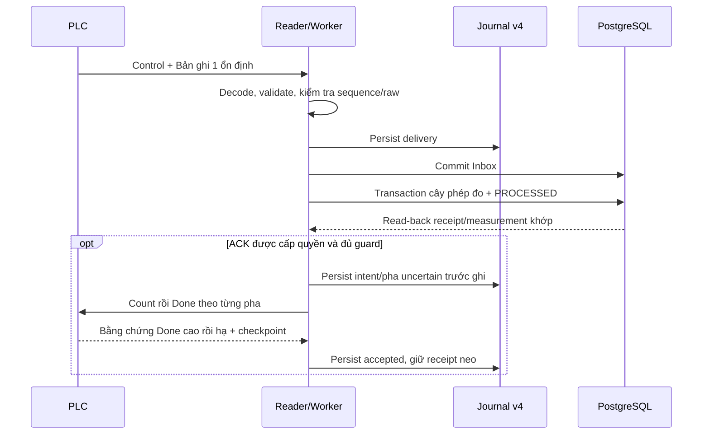
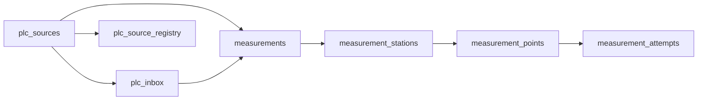

# Golf Report — Tài liệu học dự án

Đối chiếu **17/11/2026**, theo source workspace, kể cả thay đổi chưa commit. Không chạy app/test/build, kết nối PLC/DB; không chứng nhận sẵn sàng sản xuất.

Thiếu `X212PI-Register-Mapping-PLC-Software(20261117-000814).xlsx`. Đã đọc ba sheet của [docs/X212PI-Register-Mapping-PLC-Software.xlsx](docs/X212PI-Register-Mapping-PLC-Software.xlsx), SHA-256 `ba9577a90b724cde8a348d31b468572bce50b1f2de871e900e3ab365a102cf07`. Chưa xác minh tương đương bản yêu cầu. PDF chỉ tham khảo giao diện.

## Mục lục

1. [Tổng quan](#1-tổng-quan)
2. [Cấu trúc thư mục](#2-cấu-trúc-thư-mục)
3. [35 file/module quan trọng](#3-35-filemodule-quan-trọng)
4. [28 hàm/struct cốt lõi](#4-28-hàmstruct-cốt-lõi)
5. [Luồng hoạt động](#5-luồng-hoạt-động)
6. [Excel Register Mapping](#6-excel-register-mapping)
7. [PostgreSQL](#7-postgresql)
8. [Cấu hình và nơi lưu](#8-cấu-hình-và-nơi-lưu)
9. [Kiểm thử an toàn](#9-kiểm-thử-an-toàn)
10. [Đóng gói và triển khai](#10-đóng-gói-và-triển-khai)
11. [Kiến thức cần nhớ](#11-kiến-thức-cần-nhớ)

## 1. Tổng quan

Golf Report thu kết quả gậy từ PLC, lưu PostgreSQL, hiển thị cho QC. PLC/Ladder điều khiển đo và quyết định chất lượng; ứng dụng validate/lưu, không tính lại OK/NG từ độ cong.

QC nhập IP/Port/Unit ID, kiểm tra rồi kết nối. Thu cần baseline/map/lịch sử hợp lệ; ACK cần quyền riêng. TCP PASS không cấp quyền ghi.

| Trang/menu | Vai trò thực tế |
|---|---|
| 1 · Giám sát | SKU từ trạng thái hiện có, KPI theo SKU, gậy vừa kiểm tra, độ cong tối đa 30 gậy và bảng gần nhất |
| 2 · Lịch sử | Lọc/phân trang kết quả, mở chi tiết gậy và các lượt đo |
| 3 · Báo cáo | Thống kê theo bộ lọc, NG theo điểm, histogram BUTT, tổng hợp và xuất dữ liệu |
| 4 · Kết nối PLC | Chế độ QC/kỹ thuật, kiểm tra/lưu/kết nối/ngắt, trạng thái, vùng nhớ, nhật ký |

`/` về `/monitor`; Dashboard cũ chuyển hướng. `/measurements/:measurementId` là chi tiết, không thêm menu. Không quản lý Lô.

**Công nghệ và vai trò:**

- **Tauri 2:** ghép WebView với Rust; `invoke` gọi command được đăng ký trong `lib.rs`.
- **React + TypeScript + Vite:** dựng UI có kiểu dữ liệu; Vite phục vụ dev và đóng gói frontend.
- **Ant Design:** cung cấp Card, bảng, form, badge và thông báo tiếng Việt.
- **Rust:** quản lý I/O, kiểm tra dữ liệu, Worker, Journal và quyền ghi PLC.
- **PostgreSQL + SQLx:** lưu quan hệ, transaction, unique constraint và truy vấn bất đồng bộ.
- **Modbus TCP:** đọc holding registers qua FC03; ACK có các lệnh ghi giới hạn, không dùng frontend mở socket.
- **Delta AS200 Series:** PLC đích của Register Map; hành vi Ladder thật vẫn cần nghiệm thu riêng.

Luồng phần cứng: cảm biến → PLC → Ethernet/laptop → PostgreSQL; ACK trở về PLC sau commit và kiểm tra an toàn.

## 2. Cấu trúc thư mục

```text
golf-report/
├── src/
│   ├── App.tsx, App.css, main.tsx
│   ├── layouts/MainLayout.tsx
│   ├── components/measurement/MeasurementDetails.tsx
│   ├── components/PageHeader.tsx
│   ├── hooks/usePlcMonitor.ts
│   ├── pages/{AddMeasurement,MeasurementHistory,MeasurementDetail,Reports,ConnectionSettings}/
│   ├── services/{measurementService,as200Service,plcConnectionService}.ts
│   └── utils/{as200Report,as200Export,reportTime}.ts
├── src-tauri/
│   ├── src/
│   │   ├── lib.rs, main.rs
│   │   ├── commands/measurement_command.rs
│   │   ├── database/, models/, enums/, repositories/, services/
│   │   ├── plc/
│   │   │   ├── connection_settings.rs, simulator_config.rs, register_access.rs
│   │   │   ├── as200/{map,decode,model,reader,ack,heartbeat,tests}.rs
│   │   │   └── worker.rs, worker/{journal,capture,delivery,ack,recovery,retry,tests}.rs
│   │   └── bin/{as200-reader,as200-db}.rs
│   ├── migrations/
│   ├── resources/database_config.toml
│   ├── Cargo.toml, tauri.conf.json
│   └── installer-hooks.nsh, installer-permissions.wxs
├── docs/X212PI-Register-Mapping-PLC-Software.xlsx
├── local-runtime/                 # chỉ xuất hiện khi có runtime
├── .simulator-tests/              # môi trường TEST riêng
├── as200_config.toml, as200_config.example.toml
├── plc-register-access.toml
└── package.json, package-lock.json, vite.config.ts, tsconfig.json
```

`src` chứa UI và service gọi Rust. Backend: `plc` xử lý PLC/Journal; `services` điều phối transaction; `repositories` thực thi SQL; `models` định nghĩa DTO; `migrations` tạo schema. Test nằm cạnh module (`tests.rs`, `*.test.ts[x]`). Không có thư mục `tools/`.

Ngoài repo: `../as200-simulator/{as200_simulator.py,test_as200.py,requirements.txt}`, `../reset-golf-report.ps1`; không tự đóng gói chúng vào Setup.

## 3. 35 file/module quan trọng

Đường dẫn theo root; mỗi mục là file hoặc nhóm/module. Rủi ro xét thay đổi chức năng.

| # | File/module | Vai trò, nội dung chính | Khi sửa | Rủi ro |
|---|---|---|---|---|
| A1 | `src/App.tsx` | Router, lazy pages, theme | Route/theme | Thấp |
| A2 | `src/layouts/MainLayout.tsx` | Sidebar, header, nguồn polling dùng chung | Bố cục/trạng thái | Trung bình |
| A3 | `src/hooks/usePlcMonitor.ts` | Outlet context và nhãn trạng thái có bằng chứng | Trình bày trạng thái | Trung bình |
| A4 | `src/pages/AddMeasurement/AddMeasurement.tsx` | Tải KPI, chi tiết, chart và bảng theo SKU | Giám sát | Trung bình |
| A5 | `src/pages/AddMeasurement/MonitorPanels.tsx` | Các panel/bảng/đường độ cong | Hiển thị đo | Thấp |
| A6 | `src/pages/MeasurementHistory/MeasurementHistory.tsx` | Bộ lọc, phân trang lịch sử | Tra cứu | Trung bình |
| A7 | `src/pages/Reports/Reports.tsx` | KPI, chart, bộ lọc báo cáo | Thống kê UI | Trung bình |
| A8 | `src/pages/ConnectionSettings/ConnectionSettings.tsx` | QC/kỹ thuật, kết nối | Luồng vận hành | Cao |
| A9 | `src/services/{measurementService,as200Service,plcConnectionService}.ts` | DTO và `invoke` | Contract API | Trung bình |
| A10 | `src/utils/{as200Report,as200Export}.ts` | Mapping báo cáo, CSV/Excel | Tổng hợp/xuất | Trung bình |
| B1 | `src-tauri/src/lib.rs` | Setup, đường dẫn, quyền ghi, đăng ký command | Khởi động | Cao |
| B2 | `src-tauri/src/commands/measurement_command.rs` | Cổng API DB cho frontend | API đọc | Trung bình |
| B3 | `src-tauri/src/plc/connection_settings.rs` | Draft, probe, nguồn endpoint, chuyển nguồn | Kết nối | Cao |
| B4 | `src-tauri/src/plc/simulator_config.rs` | Parse/validate cấu hình và ACK scope | Tham số runtime | Cao |
| B5 | `src-tauri/src/plc/as200/map.rs` | Offset, kích thước, giới hạn đọc | Map đã xác minh | Cao |
| B6 | `src-tauri/src/plc/as200/decode.rs` | WORD → DINT/REAL/record | Giải mã | Cao |
| B7 | `src-tauri/src/plc/as200/model.rs` | Struct và validation workflow | Quy tắc dữ liệu | Cao |
| B8 | `src-tauri/src/plc/as200/reader.rs` | FC03, timeout, snapshot ổn định | Truyền thông | Cao |
| B9 | `src-tauri/src/plc/as200/ack.rs` | Intent, pha ACK, writer giới hạn | Giao thức ACK | Cao |
| B10 | `src-tauri/src/plc/worker.rs` | Lifecycle, telemetry, vòng thu | Worker | Cao |
| B11 | `src-tauri/src/plc/worker/{journal,capture}.rs` | Persist v4, binding, capture | Bền vững | Cao |
| B12 | `src-tauri/src/plc/worker/{delivery,retry}.rs` | Inbox, retry/backoff | Phục hồi DB | Cao |
| B13 | `src-tauri/src/plc/worker/{ack,recovery}.rs` | Điều phối ACK, đối chiếu lịch sử | Chuyển nguồn/reset | Cao |
| B14 | `src-tauri/src/services/{inbox_service,measurement_service}.rs` | Validate, tạo cây kết quả, commit | Nhập dữ liệu | Cao |
| C1 | `src-tauri/src/database/{config,connection,migrations}.rs` | File ngoài, pool, migration | Kết nối DB | Cao |
| C2 | `src-tauri/src/models/{measurement,inbox}.rs` | DTO, bản ghi và trạng thái | Contract dữ liệu | Trung bình |
| C3 | `src-tauri/src/repositories/measurement_repository.rs` | List, batch điểm, thống kê SQL | Truy vấn | Trung bình |
| C4 | `src-tauri/src/repositories/inbox_repository.rs` | SourceRepository/InboxRepository, lock, dedup | Ingest | Cao |
| C5 | `src-tauri/migrations/20261109120000_initialize_as200.sql`, `20261111120000_plc_source_registry.sql` | Bảng, FK, unique, registry | Schema có kiểm soát | Cao |
| D1 | `src-tauri/tauri.conf.json`, `Cargo.toml`, `package.json` | Bundle, dependencies, scripts | Build | Trung bình |
| D2 | `as200_config.toml`, `as200_config.example.toml` | Cấu hình hoạt động và mẫu | Thiết lập | Cao |
| D3 | `src-tauri/resources/database_config.toml` | Bí mật kết nối DB ngoài binary | Triển khai | Cao |
| D4 | `plc-register-access.toml`, `src-tauri/src/plc/register_access.rs` | Công cụ kỹ thuật tùy chọn, allowlist | Quyền đọc/ghi kỹ thuật | Cao |
| E1 | `../as200-simulator/{as200_simulator.py,test_as200.py}` | Fixture và mô hình thử nghiệm | Test cô lập | Cao |
| E2 | `src-tauri/src/bin/{as200-reader,as200-db}.rs` | CLI đọc PLC / công cụ DB | Chẩn đoán có kiểm soát | Cao |

CSS nằm cạnh trang; `MeasurementDetails.tsx` trình bày điểm/lượt. `as200/heartbeat.rs` theo dõi heartbeat; repository station/point/attempt lưu cây con.

## 4. 28 hàm/struct cốt lõi

Quy ước đường dẫn ngắn: `R=src-tauri/src`, `P=R/plc`, `W=P/worker`, `F=src`. Cột xử lý nêu tác dụng phụ; “thuần” nghĩa không I/O.

| # | File | Hàm/struct | Đầu vào | Xử lý chính | Đầu ra | Được gọi bởi |
|---|---|---|---|---|---|---|
| 1 | `R/lib.rs` | `run` | Runtime Tauri | State, setup, task | App đang chạy | `main.rs` |
| 2 | `R/lib.rs` | `application_directory` | Debug/release | Xác định root | `Result<PathBuf>` | Setup, config loader |
| 3 | `R/database/config.rs` | `load_config` | File DB ngoài | Đọc TOML | `DatabaseConfig` | `connect_and_migrate` |
| 4 | `R/database/connection.rs` | `DatabaseState::initialize` | AppHandle | Pool + migrate DB | `DatabaseStatus` | Setup, retry command |
| 5 | `P/connection_settings.rs` | `save_plc_runtime_settings` | RuntimeSettings, State | Ghi draft, không bật Worker | Kết quả lưu | Service frontend |
| 6 | như trên | `inspect_endpoint` | Cấu hình đích | TCP + FC03 chỉ đọc | `InspectionReport` | Test/connect flow |
| 7 | như trên | `endpoint_source_key` | Endpoint | Chuẩn hóa IP/Port/Unit, thuần | SourceKey ổn định | Chuẩn bị nguồn |
| 8 | như trên | `connect_verified_plc` | Endpoint, revision, State/DB | Điều phối kiểm tra/chuyển/khởi động | `ConnectionOutcome` | `plcConnectionService.ts` |
| 9 | `P/worker.rs` | `WorkerState::stop_collection` | State | Marker, join, flush DB | `Result<()>` | Lệnh ngắt/chuyển nguồn |
| 10 | như trên | `WorkerState::launch` | Root, DatabaseState | Gate, mở config/Journal, tasks | Bất đồng bộ | Setup/connect flow |
| 11 | `P/as200/reader.rs` | `As200Reader::poll_published_record` | Reader config | FC03/control/raw lặp | `PublishedRecordSnapshot` | Worker, probe baseline |
| 12 | `P/as200/decode.rs` | `record` | 240 WORD, index, WordOrder | Giải mã thuần | `PlcStickRecord` | Reader, Inbox, capture |
| 13 | `P/as200/model.rs` | `PlcStickRecord::validate_workflow` | Record | Kiểm tra điểm/lượt/kết quả | `Result<()>` | Capture, draft, ACK |
| 14 | `W/capture.rs` | `Engine::capture_published_snapshot` | Snapshot | Validate, persist Journal | `Result<()>` | Vòng thu |
| 15 | `W/journal.rs` | `Engine::persist` | Journal | tmp, sync, rename file | `Result<()>` | Chuyển trạng thái |
| 16 | `W/delivery.rs` | `Engine::persist_receipts` | PgPool | Source + Inbox commit | Source ID | `flush` |
| 17 | `R/services/inbox_service.rs` | `draft_from_inbox` | InboxRecord | Decode/validate, NULL đúng | MeasurementDraft | Process/retry |
| 18 | như trên | `InboxService::process` | Pool, Inbox ID | Transaction, lưu cây đo | InboxRecord | Backend retry |
| 19 | `R/repositories/inbox_repository.rs` | `InboxRepository::receive` | Transaction, InboxInput | Dedup/đối chiếu DB | InboxRecord | `InboxService::receive` |
| 20 | `W/ack.rs` | `Engine::published_ack_step` | Snapshot, pool | DB read-back, persist pha, ghi ACK có guard | `Result<()>` | Vòng published |
| 21 | `P/as200/ack.rs` | `PublishedAckIntent` | Target, raw, Inbox ID, pha | Giữ bằng chứng; kiểm tra/confirm thuần | Intent/boolean/error | Worker ACK |
| 22 | như trên | `AckWriter::count` | Target DINT | FC16 checkpoint được cho phép | `Result<()>` | `published_ack_step` |
| 23 | như trên | `AckWriter::done_prepared` | Socket chuẩn bị | FC06 Done=1 | `Result<()>` | `published_ack_step` |
| 24 | `W/recovery.rs` | `WorkerState::verify_resume` | Config, DB, trace | FC03 + Journal/DB đối chiếu | Điều kiện reset/tiếp tục | Connect flow |
| 25 | `R/repositories/measurement_repository.rs` | `MeasurementRepository::history_page` | Pool, bộ lọc/page | SELECT list + batch điểm | History page | Command/service |
| 26 | như trên | `MeasurementRepository::quality_statistics` | Pool, bộ lọc | SELECT tổng hợp quyết định | Quality statistics | Command/service |
| 27 | `F/services/measurementService.ts` | `getMeasurementHistoryPage` | Request | `invoke` Rust command | Promise page | Monitor/History |
| 28 | `F/utils/as200Export.ts` | `createExcelBytes`, `createCsvBytes` | Rows, details (CSV tùy chọn) | Tạo bytes, không PLC/DB | Bytes/Promise bytes | Xuất báo cáo |

Tổng cộng **28 mục, 29 tên hàm/struct**. `worker/ack.rs` điều phối; `as200/ack.rs` cung cấp transport/bằng chứng.

## 5. Luồng hoạt động

### A. Mở ứng dụng

`main.rs` gọi `lib.rs::run`. Setup quản lý state và kiểm tra thư mục ghi. Một task bất đồng bộ gọi `DatabaseState::initialize` rồi `WorkerState::launch`. WebView/React có thể render trong lúc task đang chạy; không có chuỗi cứng “DB xong mới tạo React”. Pool có migration trước khi được công bố. UI dùng trạng thái để hiển thị đang kết nối/lỗi.

### B. QC kết nối

UI → `plcConnectionService.ts` → command. QC có Kiểm tra/Kết nối; kỹ thuật thêm Lưu. Draft có revision, không phải cấu hình Worker.

Backend chuẩn hóa IP/Port/Unit thành SourceKey endpoint, tìm hồ sơ cũ hoặc chuẩn bị nguồn riêng. Nguồn tự động mới cần baseline sạch: counter/checkpoint/Done/DataReady bằng 0, vùng công bố rỗng, snapshot ổn định. Tạo session initial và Journal v4 rỗng; **ACK mặc định tắt**. Có lịch sử DB nhưng thiếu Journal không được tự thay bằng session mới.

Nguồn cũ phải dừng, flush và đối chiếu trước chuyển. Với chế độ chỉ đọc, backend xác minh toàn bộ receipt đã xử lý, không giả tăng accepted. Registry vật lý/ACK vẫn được dùng cho nguồn có cấp quyền; không bắt QC nhập Serial. IP mới là nguồn logic riêng theo quy ước hiện tại, không chứng minh thiết bị vật lý mới.

### C. Một gậy đo xong



Ví dụ seq=7 lưu dưới `(source,session,7)`; StickNo có thể trùng. Commit/read-back xong mới xét ACK. TotalCount>7 vẫn chặn ghi. FC06 echo không chứng minh PLC đã xử lý.

Các pha: `Prepared` → `CountWriteUncertain` → `CountVerified` → `DoneWriteUncertain` → `AckConfirmed`. Persist lỗi chặn ghi; mất phản hồi không tự gửi lại. Xác nhận cần thấy Done=1 rồi snapshot phù hợp Done=0.

### D–F. Sự cố

- **Mất PLC:** Reader timeout/transport error, Worker báo mất kết nối và thử lại theo cấu hình. Telemetry phân biệt lần chuyển sang disconnected với retry lặp; dừng chủ động không tính mất kết nối. Bộ đếm UTC+7 chỉ trong phiên ứng dụng, không phải lịch sử đầy đủ cả ngày.
- **Lỗi PostgreSQL:** delivery đã persist giữ trong Journal; retry dùng cùng identity, backoff và giới hạn. Chưa có PROCESSED hợp lệ thì không ACK. Queue/diagnostic đầy gây pause, không xóa bằng chứng để tiếp tục.
- **Restart:** mở khóa Journal, validate binding/version và đối chiếu DB; giữ intent chưa rõ. Không diễn giải khởi động lại là ACK thất bại để phát lại.
- **RESET:** counter giảm so với lịch sử gây dừng/đối chiếu; cùng endpoint không tự đổi session. Session ngăn seq=1 sau reset bị coi là seq=1 cũ. Baseline rỗng chỉ là điều kiện cần, không phải chứng cứ tự cấp quyền reset.

### G. Đọc lịch sử/báo cáo

React → service `invoke` → `measurement_command.rs` → `MeasurementService` → repository → SELECT PostgreSQL. Không đọc Modbus để dựng báo cáo. Monitor lấy page 1, size 30 theo SKU hiện có, đảo sang thứ tự cũ→mới cho chart; bảng gần nhất phân trang 6 hàng riêng, batch Bend theo ID. Không đợi đủ 30 mẫu và không chặn chart vì thiếu setpoint.

## 6. Excel Register Mapping

Đã đọc `Tong_quan` (layout), `Vung_dieu_khien` (control/quyền ghi), `Cau_truc_ban_ghi` (record). Workbook tham chiếu `Ghi_chu` nhưng không chứa sheet này.

### Vùng nhớ được xác nhận

Địa chỉ là **D-register**, không phải 4xxxx.

| Thanh ghi/vùng | Kiểu | Ý nghĩa | Source đọc/ghi |
|---|---|---|---|
| D25000 / 25001 / 25002 | INT | FormatVersion=1 / RecordSize=240 / BufferCount=2 | `as200/decode.rs::control` đọc |
| D25003 / D25006 | INT | WriteIdx / LastIdx, 0–1 | `decode.rs` đọc |
| D25004–25005 | DINT | TotalCount | Reader/decoder đọc |
| D25007 | INT | PLC Heartbeat, tăng/giây, vòng 0–32767 | Reader + `heartbeat.rs` |
| D25008–25009 | DINT | PC_ReadCount | Reader đọc; `AckWriter::count` ghi |
| D25010 | INT | PC_Heartbeat | Decoder đọc; Worker hiện không ghi |
| D25011 | BOOL lưu INT | DataReady | Reader đọc |
| D25012 | BOOL lưu INT | PC_ReadDone | Reader đọc; writer ghi 1 |
| D25013–25019 | INT[7] | Reserve control | Decoder giữ |
| D25020–25259 | 240 WORD | Buffer 1, index 0 | Published Reader đọc |
| D25260–25499 | 240 WORD | Buffer 2, index 1 | PLC quản lý; không phải nguồn published thứ hai |
| D25020 / D25021 | INT / WORD | Version / Status | `decode.rs::record` |
| D25022–25023 | DINT | StickNo | Decoder |
| D25024–25033 | WORD[10] | SKU ASCII tối đa 20 ký tự | `product_code` |
| D25040 / D25042–25043 | INT / DINT | OverallResult / RecordSeq | Decoder/model |
| D25044–25049 | INT + REAL | BUTT Result, PointCount, NGPoint, reserve, Load | `station` |
| D25140–25145 | INT + REAL | TIP tương ứng | `station` |
| D25052/25074/25096/25118 | Điểm 22 WORD | Đầu BUTT P1/P2/P3/P4 | `point` |
| D25148/25170/25192/25214 | Điểm 22 WORD | Đầu TIP P1/P2/P3/P4 | `point` |
| D25236–25259 | INT[24] | Reserve_End | Decoder giữ |

Buffer 2 cộng 240; tổng vùng 20 + 2×240 = 500 WORD.

### Cấu trúc và ý nghĩa

Một điểm: Result(+0), AttemptCount(+1), DecideAttempt(+2), reserve(+3), Position REAL(+4..5), rồi bốn cặp PushDist/Bend REAL ở +6/+8, +10/+12, +14/+16, +18/+20. Ví dụ BUTT P1 có Position D25056–57, A1 Push D25058–59, A1 Bend D25060–61. Load là tải trạm, không phải lực riêng được đo lại cho từng attempt.

SKU dùng hai ký tự/WORD, ký tự đầu ở byte thấp, đệm NUL. DINT/REAL dùng hai WORD; `LOW/HIGH` quyết định thứ tự WORD 32-bit, khác thứ tự byte ASCII. REAL không tự chia 100. Offset PDU = D address + cấu hình offset; Excel ghi 0 nhưng yêu cầu thử thiết bị thực tế.

PointCount là số điểm đã đo trước khi dừng; AttemptCount là số lượt tại điểm; DecideAttempt chọn lượt quyết định. Code giữ tối đa bốn điểm mỗi trạm và chỉ lưu lượt thật. Vị trí điểm chưa đo là SQL NULL, UI `—`; Bend=0 thật vẫn là 0.

Excel: kết quả 0 chưa đo, 1 OK, 2 NG; không có mã 3 SKIPPED. UI dùng SKIPPED cho điểm chưa đo/bỏ qua, không đổi thành NG. Code hiện yêu cầu trạm OK có đủ bốn điểm; trạm NG có PointCount=NGPoint và điểm NG đo đủ bốn lượt. **BUTT OK + PointCount=1 bị từ chối**; BUTT NG tại P1 có thể dừng ở một điểm. Overall theo kết quả PLC, đồng thời validation yêu cầu nhất quán giữa hai trạm.

Excel mô tả PC ghi ReadCount rồi Done=1; PLC xử lý và hạ Done=0. RecordSeq bằng TotalCount tại thời điểm tạo record. Status bit0 valid, bit1 BUTT checked, bit2 TIP checked, bit3 Overall OK.

### Khác biệt cần xác minh

| Excel/bằng chứng | Code hiện tại | Kết luận |
|---|---|---|
| Công thức E133 cộng 234, F133 báo sai RecordSize; bỏ trống offset 14–19 | Giữ `unknown_header_14_19[6]`, record 240 | Lỗi tổng trong workbook; chưa sửa Excel/code |
| Hai buffer vòng, WriteIdx/LastIdx | Published chỉ đọc Bản ghi 1, PLC quản lý nội bộ | Chưa xác minh Ladder có cơ chế công bố này |
| PC_ReadCount mô tả TotalCount đã đọc | ACK theo receipt.RecordSeq; chặn nếu TotalCount > target | Chưa có bằng chứng cho phép ACK đầu hàng đợi thấp hơn tổng |
| Không chỉ rõ WordOrder 32-bit | Cấu hình hỗ trợ LOW/HIGH; ACK scope hiện LOW, offset 0 | Cần nghiệm thu bằng giá trị biết trước |
| PC_Heartbeat do PC tăng | Published Worker không ghi heartbeat | Không giả định Ladder không cần PC heartbeat |
| Xoay 90° sau lượt NG | Angle suy từ số lượt; không có trường góc đo độc lập | Không coi góc tính ra là sensor read-back |
| Không có setpoint/giới hạn theo SKU | Chart dùng Bend thật, không vẽ giới hạn giả | Thiếu dữ liệu, không đánh giá lại chất lượng |

Giới hạn FC03 100 WORD là chính sách trong `map.rs`, không phải con số do workbook quy định. Simulator PASS không xác nhận Ladder, timing Done hay quyền ghi trên PLC thật.

## 7. PostgreSQL

Hai migration tạo bảy bảng nghiệp vụ:

| Bảng | Dữ liệu và quan hệ |
|---|---|
| `plc_sources` | SourceKey duy nhất, định danh nguồn logic |
| `plc_source_registry` | Hồ sơ vật lý, endpoint, session, map verified, ACK approved; FK source |
| `measurements` | Một gậy/bản ghi: source, session, seq, SKU, StickNo, Overall |
| `measurement_stations` | Hai trạm, Result/PointCount/NGPoint/Load |
| `measurement_points` | P1–P4, Result/AttemptCount/DecideAttempt/Position nullable |
| `measurement_attempts` | Các lượt thực, PushDist/Bend nullable |
| `plc_inbox` | Raw 240 WORD JSONB, WordOrder, identity, trạng thái, measurement liên kết |



Chống trùng có unique `(source_id,session_id,record_seq)` cho session xác nhận; Inbox thêm `(source_id,ingest_key)`. Điểm/lượt có unique theo cha+số thứ tự. Retry kiểm tra receipt/raw; không chỉ “ON CONFLICT rồi bỏ qua mọi khác biệt”. StickNo không phải khóa chống trùng.

Inbox lưu raw bền vững trong DB; Journal là file cục bộ giữ delivery, pha/ý định ACK, checkpoint, pause và retry, kể cả trước khi DB nhận được. Không dùng file này thay database báo cáo. `measured_at` là thời gian PC nhận bản ghi, không phải timestamp PLC.

`quality_statistics` chọn DecideAttempt, bỏ điểm chưa đo. Histogram gom BUTT P1–P4 hợp lệ; mẫu có thể nhiều hơn gậy. NG nhóm theo SKU/trạm/điểm/vị trí, tỷ lệ = NG nhóm / tổng gậy lọc ×100; nhóm có thể chồng nhau. Card “NG nhiều nhất tại” chia **tổng Overall NG**. Đo lại đếm distinct measurement có attempt_count>1.

## 8. Cấu hình và nơi lưu

Root Dev: project; Release: thư mục executable. Không dùng AppData/ProgramData cho cấu hình/trạng thái PLC.

| File/thư mục | Mục đích; lúc đọc | Lúc ghi | Có được xóa? |
|---|---|---|---|
| `src-tauri/resources/database_config.toml` | DB Dev, lúc khởi tạo | Kỹ thuật sửa file | Không tùy tiện; có bí mật |
| `<exe>/resources/database_config.toml` | DB Release | Installer/kỹ thuật | Sao lưu trước sửa |
| `<root>/as200_config.toml` | Cấu hình Worker đã áp dụng | Luồng connect an toàn | Không xóa để vượt guard |
| `as200_config.connection-draft` | Form lưu, revision cấu hình nền | Nút Lưu | Không phải lịch sử ACK |
| `<root>/local-runtime/managed-sources/<key>/capture.json` | Journal v4 khi mở/phục hồi | Capture/pha/retry | Không xóa/sửa tay |
| `capture.lock` | Khóa sở hữu Journal | Worker mở | Không gỡ khi đang chạy |
| `target-config.toml`, `previous-config.toml` | Hồ sơ cấu hình nguồn | Chuyển/giữ hồ sơ | Giữ cùng Journal |
| `local-runtime/endpoint-links/` | Tìm lại cấu hình nguồn endpoint | Luồng chuyển nguồn | Sao lưu, không tự sửa binding |
| `as200_config.operator-stop`, `.connection-pending`, `.settings.lock` | Dừng, chuyển chưa xong, khóa settings | Backend | Không xóa để ép chạy |
| `plc-register-access.toml` | Backend kiểm tra quyền kỹ thuật | Kỹ thuật sửa | Thiếu mặc định ẩn/khóa |
| AppData/ProgramData | Không dùng cho PLC hiện tại | Không fallback | Không thao tác dữ liệu cũ |

Marker thay extension `.toml`. UI sửa endpoint/tham số; backend quản lý Source/Session/ACK. Không sửa DB secret/Journal qua form.

`check_plc_directory` thử quyền tạo/ghi/sync/rename và kiểm tra runtime path/reparse point; thiếu quyền phải báo lỗi, không bật thu/ACK hoặc chuyển sang AppData. NSIS/MSI cấp Users quyền đọc/chạy và tạo đối tượng tại root; Creator Owner quản lý đối tượng mới, không cấp Everyone Modify executable. Đổi tài khoản Windows có thể cần kỹ thuật xử lý ACL đúng runtime.

Backup config/runtime/intent khi app dừng; DB riêng. Không đưa lịch sử TEST vào Setup. Reset chỉ trong TEST cô lập/DB local `golf_report_test`. Worker từ chối Journal v1/v2/v3, không chuyển thành v4.

Database config là **file resource ngoài binary**, không `include_str!` connection string. Tuy nhiên file được đưa vào installer: ai có installer/quyền đọc file có thể lấy credential. Không phân phối mật khẩu Neon dùng chung; không ghi connection string vào log hoặc tài liệu.

## 9. Kiểm thử an toàn

**Chưa thực thi**. Dùng TEST riêng: `127.0.0.1:1503`, Unit 1, offset 0, DB local. Kiểm tra config trước mở app: startup có thể chạy migration/Worker.

Simulator hỗ trợ `--published-record`, tách khỏi `--ack-handshake` cũ và PC heartbeat writer. Menu 1 OK, 2 TIP NG, 3 BUTT NG, 4 tạo batch, 5 reset fixture, 6/7 ngắt/phục hồi, 8 xem control. Các mode lỗi ACK menu 9 chỉ cho handshake cũ; không dùng để khẳng định test v4. V4 có test mock trong `worker/tests.rs`, `as200/tests.rs`; simulator có nhánh queue/mutate/duplicate.

| Tình huống | Kết quả cần đối chiếu |
|---|---|
| 1 OK | Hai trạm/4 điểm hợp lệ, một phép đo, receipt khớp |
| TIP NG / BUTT NG | Giữ điểm NG, đủ lượt quyết định, điểm sau chưa đo là `—` |
| 10–100 bản ghi | Seq/ID không trùng; không ép ACK khi TotalCount đi trước target |
| Mất PLC/phục hồi | Lỗi đọc có thật, không cộng disconnect theo từng retry |
| ACK mất echo/từ chối | Giữ uncertain intent, không tự phát lại Done |
| DB TEST mất kết nối | Journal giữ dữ liệu, không ACK trước commit; phục hồi không trùng |
| Đóng/mở lại | Khóa, binding, receipt/pha được đối chiếu |
| Reset fixture TEST | Counter giảm bị chặn; không tự đổi session |
| Replay/cùng seq khác raw | Replay cùng dữ liệu không nhân đôi; raw khác là conflict |
| Bend âm/0/NULL, nhiều SKU | Giữ dấu/0; bỏ NULL; chart/bảng theo đúng bộ lọc |

Test DB opt-in dùng `database/test_support.rs`: yêu cầu `AS200_TEST_DATABASE=golf_report_test`, host local và xác minh server/database. Không chạy cả nhóm ignored tùy tiện; có test dùng DB và test chẩn đoán riêng. CLI `as200-reader` chỉ đọc; `as200-db` có thao tác DB, phải xem lệnh trước dùng.

## 10. Đóng gói và triển khai

Lệnh tham khảo, chưa chạy:

| Lệnh từ root | Mục đích/tác dụng |
|---|---|
| `npm run tauri dev` | Vite + Rust/Tauri dev; có thể kết nối DB/Worker theo config |
| `npm test` | Vitest frontend |
| `npm run build` | TypeScript check + Vite bundle |
| `cargo check --manifest-path src-tauri/Cargo.toml` | Kiểm tra biên dịch Rust |
| `cargo test --manifest-path src-tauri/Cargo.toml` | Test Rust; xem ignored/opt-in riêng |
| `npm run tauri build` | Build frontend, Rust release và installer |

Theo cấu hình Cargo/Tauri mặc định, EXE ở `src-tauri/target/release/golf-report.exe`; NSIS ở `src-tauri/target/release/bundle/nsis/`, MSI ở `.../bundle/msi/`. Target dir/triple tùy môi trường có thể đổi đường dẫn. `tauri.conf.json` chọn cả NSIS/MSI và map resource DB tới `resources/database_config.toml`; Journal/endpoint-links không nằm trong resource map.

Sau cài: EXE/resource DB; config PLC/runtime tạo khi cần. Kiểm tra WebView2, mạng/firewall, TLS DB cloud, quyền ghi. Thiếu/sai DB config báo tiếng Việt và cho retry, không fallback.

Trước bật ACK thật: kiểm tra Ladder công bố Buffer 1, WordOrder/offset, map/240 WORD, checkpoint semantics, timing Done cao→thấp, tình huống counter vượt record, quyền registry/scope và một chủ thể ghi. Const ACK scope trong source là chính sách phần mềm, không phải biên bản nghiệm thu. Chưa kiểm tra installer thực tế trong lượt này.

## 11. Kiến thức cần nhớ

### 15 khái niệm

| Khái niệm | Cách hiểu trong dự án |
|---|---|
| PLC | Bộ điều khiển quyết định quy trình/kết quả |
| Modbus TCP | Giao thức đọc/ghi địa chỉ qua TCP |
| Register | Ô dữ liệu được ánh xạ |
| WORD | 16 bit; REAL/DINT dùng hai WORD |
| Buffer | Vùng record; map có hai vùng 240 WORD |
| Polling | Đọc lặp với chu kỳ, có guard ổn định |
| Decoder | Chuyển raw sang dữ liệu có kiểu |
| SKU | Mã sản phẩm, không phải Lô |
| RecordSeq | Thứ tự record trong nguồn/session |
| TotalCount | Tổng record PLC đã tạo, không phải Bend |
| ACK | Xác nhận sau lưu, cần bằng chứng PLC xử lý |
| Journal | Lịch sử vận chuyển/ACK bền vững cục bộ |
| Inbox | Raw/receipt bền vững trong PostgreSQL |
| Session ID | Phân biệt các kỳ counter của một nguồn |
| SourceKey | Identity nguồn; tự động hiện theo IP/Port/Unit |

### 10 câu hỏi vấn đáp

1. **TCP PASS đủ thu chưa?** Chưa, còn Modbus/map/baseline/Journal/session.
2. **ACK gửi lúc nào?** Sau PROCESSED commit/read-back, quyền ghi và snapshot hợp lệ.
3. **Echo Done đủ chưa?** Chưa, phải có bằng chứng pha và PLC hạ Done.
4. **StickNo trùng có mất dữ liệu?** Không dùng nó làm identity; source/session/seq mới chống trùng.
5. **Bend nào lên chart?** Bend tại DecideAttempt, không phải PushDist hay mọi attempt.
6. **Điểm chưa đo là 0?** Không; vị trí NULL, UI `—`; số 0 thật vẫn giữ.
7. **BUTT OK một điểm được nhận?** Không, guard hiện tại yêu cầu bốn điểm.
8. **Sao không xóa Journal để hết lỗi?** Sẽ mất bằng chứng checkpoint/intent và chống trùng.
9. **Đổi IP tự cấp ACK?** Không; nguồn endpoint riêng mặc định chỉ đọc, baseline phải sạch.
10. **Simulator chạy được chứng minh gì?** Chỉ mô hình/test đó; chưa chứng minh Ladder thật.

### Lộ trình một ngày

- **08:00–09:00:** xem bốn trang, nhận biết trạng thái kết nối/thu/ACK khác nhau.
- **09:00–10:00:** đọc tree, `App`, layout, service và commands.
- **10:00–12:00:** theo `collection_loop` → capture → Inbox → transaction → ACK.
- **13:00–14:30:** mở ba sheet Excel, tự tính địa chỉ một điểm và so decoder.
- **14:30–15:30:** đọc schema/dedup, truy vấn quyết định và mapping NULL.
- **15:30–17:00:** học config/runtime/reset/installer; lập checklist TEST và câu hỏi Ladder chưa xác minh trước thao tác thực tế.
