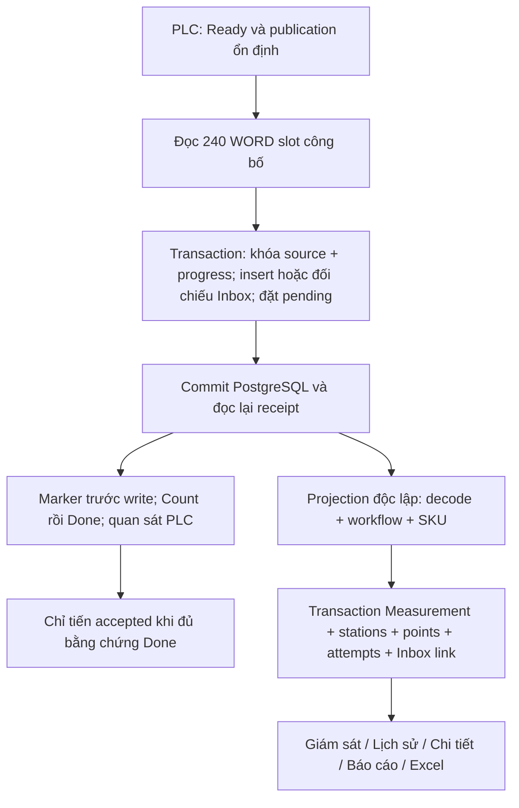

# Golf Report — audit database sau refactor

Ngày **17/11/2026, giờ Việt Nam**. **Mục A–E là snapshot audit trước cleanup; Lượt 1 ở mục F; Lượt 2 chuẩn bị retirement registry ở mục G.** Migration Lượt 2 đã kiểm chứng trên PostgreSQL test riêng, **chưa chạy trên Neon**. Bằng chứng là working tree, kể cả thay đổi chưa commit. Không dùng báo cáo cũ làm bằng chứng thay cho call site hiện tại.

**Kết luận chính:** giữ **7 bảng ứng dụng + `_sqlx_migrations` = 8 bảng** là phương án ít thay đổi và dễ bảo trì. Bảng thứ chín, `plc_source_registry`, dư thừa đối với nghiệp vụ hiện tại nhưng **vẫn có consumer CLI và guard startup**; không thể xóa độc lập trên DB hiện tại. Không có căn cứ bỏ Inbox, checkpoint ACK hoặc bốn bảng Measurement chỉ vì ứng dụng dùng một PLC.

Phạm vi kiểm kê: 49 file Rust/SQL trong `src-tauri/src` và `src-tauri/migrations`, gồm file test; đối chiếu registration Tauri, service Frontend, Giám sát/Lịch sử/Chi tiết/Báo cáo và export. Phân biệt test inline `#[cfg(test)]`, `tests.rs`, `database/test_support.rs` với code ứng dụng/CLI. Các đường Rust rút gọn dưới đây đều nằm trong `src-tauri/src/`; migration nằm trong `src-tauri/migrations/`.

Không kết nối Neon hoặc PLC, không chạy app/test/build/migration, không đọc hoặc đưa credential DB vào báo cáo. Schema bên dưới là **schema theo migration/source**, không chứng nhận catalog, row count, index usage hoặc pending ACK thực tế trên Neon hôm nay. Chưa kiểm tra khách hàng API ngoài repository, backup hoặc binary khác còn dùng registry.

## A. Bảng đánh giá

| Bảng | Chức năng | Production sử dụng? | Phụ thuộc | Kết luận |
|---|---|---|---|---|
| `plc_sources` | Namespace nguồn ổn định; parent FK và điểm khóa nhận raw | Có: `SourceRepository::upsert/lock`, Engine, legacy gate; quality query nhận diện dữ liệu demo | Inbox, acquisition, measurements, registry tham chiếu ID | **GIỮ**. Một nguồn hoạt động không đồng nghĩa không cần identity lịch sử. Có thể gộp với acquisition về lý thuyết, không khuyến nghị ở lượt tối giản này. |
| `plc_source_registry` | Hồ sơ physical identity/endpoint/quyền xác minh của thiết kế cũ | Không có trong acquisition/ACK/UI; **có** `migrations::validate_history` và CLI `as200-db::run` | FK đến sources; guard bắt tồn tại sau migration registry | **DƯ THỪA nghiệp vụ**, ứng viên loại bỏ có điều kiện. Chưa phải bảng không còn consumer production hoàn toàn. |
| `plc_inbox` | Raw receipt bền vững, identity publication, SKU đóng băng, lỗi decode/projection, link Measurement | Có: store, acquisition, InboxService/Repository, manual retry, legacy gate | FK sources/measurement; acquisition giữ pending/anchor tới Inbox | **GIỮ**. UI không có bảng RAW không làm receipt nội bộ mất vai trò. |
| `plc_acquisition` | Một checkpoint và một pending receipt của nguồn; bằng chứng trước Count/Done và block reason | Có: Engine open/poll/ACK/restart/đổi SKU | FK sources và hai FK Inbox | **GIỮ**. PROCESSED của Inbox không thay thế ACK state. |
| `measurements` | Header phép đo, SKU, số gậy, thời điểm, identity và Overall | Có: projection, query UI/report/export, legacy validation | FK sources; parent stations; Inbox liên kết 0 hoặc 1 Measurement | **GIỮ**. Không gộp với raw để ép dữ liệu chưa hoàn tất thành phép đo. |
| `measurement_stations` | Hai trạm TIP/BUTT, kết quả, load, số điểm/điểm NG | Có: insert/detail/list/history/statistics/quality/report | FK measurements; parent points | **GIỮ**. Có thể dồn vào header nếu cố định TIP/BUTT, nhưng không có lợi đủ lớn so với chi phí sửa query/DTO. |
| `measurement_points` | Điểm nghiệp vụ, result, vị trí, số lượt, lượt quyết định | Có: projection, history Bend, quality, detail/export | FK stations; parent attempts | **GIỮ**. Không phải bản sao các attempt. |
| `measurement_attempts` | Các lượt thực sự đã đo, PushDist/Bend; cần xem quá trình và decision | Có: insert/detail/report; history/quality chọn DecideAttempt | FK points | **GIỮ**. Chỉ giữ lượt quyết định sẽ mất chức năng Chi tiết/Excel. |
| `_sqlx_migrations` | Version/checksum/trạng thái migration do SQLx quản lý | Có: startup runner, audit, CLI; không có UI query nghiệp vụ | Không có FK với bảng ứng dụng | **GIỮ**. Không phải dữ liệu demo hoặc checkpoint PLC. |

### A.1 Nơi đọc/ghi và quan hệ của từng bảng

Các nơi dưới đây là **ứng dụng production và CLI đang biên dịch**, không tính fixture test hoặc file SQL dọn test. Không tìm thấy DELETE dữ liệu nghiệp vụ trong command/repository/service/Worker production hiện tại. Những chỗ trả lỗi/rollback không phải DELETE. Query SQL động trong Worker cũng được tính, không chỉ repository.

#### 1. `plc_sources`

- `repositories/inbox_repository.rs`, `SourceRepository::upsert`: INSERT, ON CONFLICT UPDATE description, RETURNING; `Engine::open` trong `worker/acquisition.rs` gọi một lần khi mở Engine, không upsert mỗi poll.
- `SourceRepository::lock`: SELECT `FOR NO KEY UPDATE`, dùng trong `Engine::receive` trước khi khóa progress và nhận publication.
- `WorkerState::verify_sku_change` ở cuối `worker/acquisition.rs`: SELECT nguồn theo SourceKey. `legacy::baseline` JOIN sources để đối chiếu prefix lịch sử. `MeasurementRepository::quality_statistics`: EXISTS sources để chỉ áp giới hạn DEMO cho đúng source simulator, không áp ngưỡng demo lên production.
- CLI `bin/as200-db.rs::run` SELECT count. Các test tạo nguồn riêng không phải tính năng runtime quản lý nhiều PLC.
- PK `id`; UNIQUE `source_key`, CHECK key sau btrim không rỗng; description nullable, created_at default now. FK từ measurements/Inbox/registry dùng ON DELETE RESTRICT; FK acquisition mặc định NO ACTION.
- Không chứa accepted/ACK phase, quyền ghi PLC hoặc serial. Không có CRUD nguồn/UI chuyển nguồn. Bảng có khả năng chứa lịch sử nhiều nguồn không có nghĩa app đang điều phối nhiều PLC.

#### 2. `plc_source_registry`

- Không có SELECT/INSERT/UPDATE/DELETE từ Engine, InboxService, MeasurementService hoặc UI.
- Consumer còn lại: `database/migrations.rs::validate_history` kiểm tra tên bảng khi history có `REGISTRY_VERSION`; `migrate` còn liệt kê bảng trong query chẩn đoán; `bin/as200-db.rs::run` SELECT count/distinct session/count approved.
- PK đồng thời FK `source_id → plc_sources.id`, ON DELETE RESTRICT; UNIQUE physical_identity; UNIQUE endpoint_ip/endpoint_port/unit_id; CHECK identity/session không rỗng, port 1–65535, unit 1–247, quyền ACK approved chỉ khi AS200 verified. Không có bảng khác FK tới registry.
- Toàn bộ physical_identity, endpoint, device verification và các cờ ở đây **không cấp quyền cho AckWriter**. Quyền hiện lấy config + binding + heartbeat + receipt/progress, không đọc registry. Giữ một registry không được Worker tham vấn có thể gây hiểu nhầm về quyền.
- Kết luận chính xác: dư thừa về nghiệp vụ, chưa dư thừa về khả năng khởi động binary hiện tại. Không gộp các cờ này sang source vì việc đó đưa lại một subsystem không được dùng.

#### 3. `plc_inbox`

- `worker/store.rs::Engine::receive`: transaction khóa source/progress, SELECT publication cùng identity `FOR UPDATE`, INSERT raw khi chưa có; đối chiếu payload khi đã tồn tại, không ghi đè raw. Raw receipt và pending pointer commit cùng transaction. Conflict được latch vào acquisition.
- `InboxRepository::find/lock`: SELECT theo ID; `processed`: UPDATE PROCESSED/link/processed_at, xóa lỗi trong transaction projection; `failed`: UPDATE lỗi có điều kiện, không đè lên row đã PROCESSED.
- `Engine::receipt`, `refresh_display`, `show_receipt`, `project_pending`, `process_receipt` (`worker/acquisition.rs`): đọc receipt/queue; ghi decode_error hoặc chuyển SESSION_UNCONFIRMED sang PENDING khi projection hợp lệ. `verify_sku_change` kiểm tra hàng chờ. `legacy::baseline` đối chiếu Inbox cũ/anchor/prefix.
- `InboxService::process_in_transaction` khóa Inbox, đọc draft và link; `process` retry cùng ID. `worker.rs::retry_as200_inbox` kiểm nguồn rồi gọi service, không sửa checkpoint.
- API cũ `get_plc_raw_snapshots → InboxRepository::raw_snapshots` vẫn SELECT nhưng đã không còn caller Frontend. Loại bỏ API này không thay luồng lưu raw.
- PK `id`; FK source; UNIQUE nullable `measurement_id → measurements.id`; UNIQUE `(source_id, ingest_key)`; UNIQUE partial `(source_id, session_id, record_seq)` cho session cũ; UNIQUE partial `(source_id, publication_session, publication_count)` cho publication mới.
- CHECK raw JSONB bằng hàm `as200_valid_registers`: đúng 240 số nguyên 0–65535, **không cấm toàn 0**. CHECK word_order LOW/HIGH, buffer 0/1, key không rỗng, session cũ nếu có không rỗng.
- CHECK status chỉ PENDING/FAILED/PROCESSED/SESSION_UNCONFIRMED; PROCESSED tương đương có Measurement và processed_at; các status khác không được có hai giá trị đó; FAILED tương đương có error_message. Publication identity hoặc cả hai NULL, hoặc Session dài 1–128 và count ≥0. Migration publication nới session/status invariant chỉ cho row có publication_session; không xóa invariant của lịch sử cũ.
- Không có FK/UNIQUE nào chứng minh quality hoặc đã ACK. `decode_error` là lỗi giải mã; `error_message` là lỗi xử lý transaction/projection. Không tự gộp hai trường nếu chưa giữ được retry policy: queue hiện bỏ row có decode_error.
- UI chính thức không query raw table nữa; Inbox vẫn gián tiếp cung cấp lastSavedId/trạng thái lưu và là nguồn projection cho toàn bộ báo cáo.

#### 4. `plc_acquisition`

- `store::progress`: SELECT row theo source. `Engine::open`: INSERT initial state sau legacy gate; kiểm tra binding/Session/anchor. `Engine::receive`: SELECT FOR UPDATE rồi UPDATE pending/last_total cùng transaction raw. `Engine::block`: UPDATE block reason bền vững.
- `Engine::poll_and_ack_published`: SELECT progress/receipt, UPDATE last_total và CAS ack_attempted. `first_done`: CAS done_started; `observe_ack`: UPDATE done_observed, rồi accepted/anchor/pending khi đủ proof; `release_unsent_marker`: UPDATE marker chỉ trong cửa sổ chắc chắn chưa gọi transport của task đang sở hữu.
- `refresh_display`/`receipt_ack_status` suy trạng thái của đúng receipt; `verify_sku_change` chỉ cho đổi SKU khi checkpoint/PLC idle khớp. Không có query báo cáo đọc bảng này.
- PK đồng thời FK source; FK `anchor_inbox_id` và `pending_inbox_id` tới Inbox, mặc định NO ACTION. CHECK accepted≥0, last_total≥accepted; session dài 1–128; done_observed đòi ack_attempted; pending NULL đòi không attempted/observed; done_started=true đòi attempted; done_observed không được đi với done_started=false.
- `done_started` nullable có chủ ý: NULL là attempted cũ không biết Done đã gửi chưa. Không đổi NULL thành false khi đơn giản hóa.
- FK hiện kiểm tồn tại row, **không tự buộc pending/anchor cùng source/session**; Engine kiểm ở application. Tương tự Inbox link Measurement có FK/UNIQUE nhưng không tự kiểm cùng identity. Không coi mọi invariant đã được DB chứng minh, và không bỏ predicate application khi chưa có cơ chế tương đương.
- Binding có endpoint/unit/map/word order/source/session; accepted là counter đã xác nhận, last_total là counter cao nhất đã quan sát. Hai counter có thể khác nhau hợp lệ khi có publication chờ, không phải hai bản checkpoint thừa.

#### 5. `measurements`

- INSERT tại `MeasurementRepository::insert`, được gọi qua `MeasurementService::insert` trong transaction projection của InboxService. Parent và toàn bộ cây con + link Inbox commit/rollback cùng nhau. MeasurementService công khai không phải một command UI nhập phép đo thủ công.
- SELECT tại `MeasurementRepository::{sku_options,sku_summary,history_page,list,find_by_id,statistics,quality_statistics,report}`; helper `filter` và JOIN TIP/BUTT dùng lại. `refresh_display` SELECT Measurement ID gần nhất; `legacy::baseline` kiểm link/epoch/history. CLI SELECT count.
- Không có UPDATE/DELETE Measurement production tìm thấy. Bốn bảng nghiệp vụ là projection được giữ, không phải cache tự xóa được.
- PK id; FK source RESTRICT; UNIQUE partial `(source_id,session_id,record_seq)` khi session không NULL; CHECK session nếu có không rỗng, Overall thuộc UNMEASURED/OK/NG. Index SKU/số gậy/thời gian/kết quả. DB không cấm seq=0; không có UNIQUE theo StickNo hoặc nội dung payload.
- UI các trang và Excel đọc Measurement thật. SKU `product_code` của publication mới là assigned_sku đóng băng; không đồng nhất nó với ASCII ProductCode của PLC trong raw. measured_at lấy received_at, không phải timestamp tự có trong PLC.

#### 6. `measurement_stations`

- `StationRepository::insert/load` ghi/đọc cây; `load` gọi PointRepository. `MeasurementRepository` LEFT JOIN hai alias TIP/BUTT cho list/summary/statistics; history/quality JOIN station; `report` SELECT batch bằng ANY IDs. CLI count.
- PK id; FK measurement RESTRICT; UNIQUE `(measurement_id,station_type)`; CHECK TIP/BUTT, Result enum, point_count/ng_point 0–4, load NUMERIC hữu hạn. created_at do DB điền.
- Constraints chưa buộc đúng hai station/Measurement hoặc TIP chỉ P1; workflow/service kiểm các điều đó. Load 0/âm không bị CHECK loại bỏ.
- Trạm tách khỏi điểm để giữ load/result/count dù điểm sau bị skip; hai alias không nhân số row vì UNIQUE station_type theo Measurement. Không phải JOIN multi-PLC.

#### 7. `measurement_points`

- `PointRepository::insert/load`; load gọi AttemptRepository. `MeasurementRepository::history_page` đọc decision Bend bằng một query batch cho trang; `quality_statistics` đọc Result/Count/Position/DecideAttempt; `report` batch tree; CLI count.
- PK id; FK station RESTRICT; UNIQUE `(station_id,point_number)`; CHECK point 1–4, Result enum, attempt_count 0–4, DecideAttempt 1–4 và ≤count khi không NULL; position nullable NUMERIC hữu hạn.
- Điểm chưa đo vẫn có identity nghiệp vụ, Position/DecideAttempt NULL và không có attempt; UI suy SKIPPED theo trạm NG, không có SQL enum SKIPPED. Số đo 0 đã đo không phải NULL. Count/decide/result là metadata, không suy từ Bend.

#### 8. `measurement_attempts`

- `AttemptRepository::insert/load`; `report` SELECT batch; history/quality LEFT JOIN đúng `attempt_number=decide_attempt`; CLI count. Chỉ các lượt đã thực hiện được insert.
- PK id; FK point RESTRICT; UNIQUE `(point_id,attempt_number)`; CHECK attempt 1–4, push_dist/bend nullable và hữu hạn. NUMERIC không áp giới hạn chất lượng hoặc cấm 0/âm.
- Chi tiết và Excel dùng mọi attempt, quality chỉ dùng decision; hai mục đích không trùng. Không thể xóa bảng chỉ vì chart chỉ vẽ một giá trị mỗi điểm.

#### 9. `_sqlx_migrations`

- `database/migrations.rs::{audit,validate_history,migrate}` SELECT catalog/history rồi gọi `MIGRATOR.run(&pool)`; `DatabaseState::connect_and_migrate` dùng đúng pool vừa kết nối và chỉ publish pool sau thành công. `lib.rs::run` await initialize DB trước launch Worker.
- SQLx nhúng bốn migration theo thứ tự `20261109120000 → 20261111120000 → 20261117120000 → 20261117130000`. Runner quản lý tracking/checksum/lock; application không INSERT/UPDATE tracking thủ công.
- Đối chiếu source dependency cục bộ `sqlx-postgres-0.9.0/src/migrate.rs::ensure_migrations_table`: PK version bigint; description, installed_on(default now), success, checksum bytea, execution_time đều NOT NULL; không FK tới business tables. Forward runner INSERT tracking và UPDATE execution_time; đường revert của thư viện có thể DELETE version, **không phải đường startup được application gọi**.
- CLI SELECT metadata/history và có nhánh migrate khi được yêu cầu; trong audit này không chạy CLI. Không xóa/sửa checksum/version cũ để loại registry.

### A.2 Luồng và giới hạn transaction



Trong `WorkerState` chỉ có một task/Engine; `collection_loop` gọi poll/ACK rồi projection theo lịch. DB row progress/CAS và lock file giữ quyền ghi; không có task mới cho mỗi nguồn. Projection có quota/cursor nhóm PENDING/FAILED; lỗi quality không quyết định raw ACK. Diagram thể hiện hai trách nhiệm độc lập, không khẳng định luôn có Measurement trước/sau đúng một FC06.

PostgreSQL và PLC không có chung transaction. Commit raw trước write là bắt buộc; commit mất response phải đối chiếu cùng publication. Count/Done timeout không chứng minh request chưa tới PLC. Một laptop vẫn có crash/power loss và cần evidence durable.

## B. Những thành phần dư thừa và phần chỉ có thể giản lược

### B.1 Có thể dọn source mà không đổi schema

| Thành phần chính xác | Bằng chứng hiện tại | Đề xuất/phạm vi |
|---|---|---|
| `commands/measurement_command.rs::get_plc_raw_snapshots` | Còn đăng ký tại `lib.rs::run`; không có invoke/wrapper Frontend sau khi gỡ bảng RAW | Xóa registration/command, `InboxRepository::raw_snapshots`, DTO `models/inbox.rs::PlcRawSnapshot` sau đối chiếu test/CLI. Không xóa Inbox/receipt. |
| `connection_settings.rs::read_plc_register_words`, `RegisterWordsReport`, parser `RegisterReadConnection` | Không có invoke Frontend; công cụ đã gỡ | Xóa chain riêng FC03 của command nếu không cần public API ngoài repo. Không xóa FC03 acquisition hoặc gate mà Test connection còn dùng. |
| `plc/register_access.rs` với `get_plc_register_ui_enabled/get_plc_register_access/read_plc_register/write_plc_register` | Vẫn là module production và registration; không còn component/service Frontend gọi; không có SQL registry consumer | Có thể loại toàn module và registration sau kiểm kê call site test/helper. Không chuyển quyền ghi tùy ý này vào AckWriter. Giữ file policy/config hiện hữu theo yêu cầu, không cần xóa để dọn code. |
| `WorkerStatus::published_record_seq` | Chỉ producer/reset ở `worker.rs::read_snapshot/launch_under_gate`; không còn field type/caller UI | Có thể bỏ telemetry field/serialization; không xóa RecordSeq raw hoặc identity DB. |
| `RawCaptureStatus::raw_registers`, `kind` | UI không còn đọc rawCapture; `kind` đặt hằng UNDECODED. Acquisition vẫn đọc `raw_capture.received_at` và `.is_some()` | Có thể bỏ payload khỏi status DTO, giữ receipt metadata/đánh dấu needed-for-display. **Không xóa toàn bộ raw_capture ngay**: idle state và chống ghi đè receipt cũ còn consumer nội bộ. |
| Comment `plc/mod.rs` còn nói durable journal delivery | Implementation Journal writer đã mất, hiện DB receipts + read-only cutover | Chỉ sửa mô tả cho đúng; không phải lý do viết lại acquisition. |

Không tìm thấy caller Frontend cho **6 command** raw/register phía trên, nhưng chúng còn được đăng ký nên không gọi là Rust unreachable. Không có bằng chứng extension/automation ngoài repo có dùng chúng hay không. `get_measurements` **vẫn được Reports gọi**; không xóa vì Giám sát dùng history_page. Các command connect/test/stop/save settings/SKU/status/reconnect/retry DB/Inbox/report đều có consumer hiện hành.

`worker.rs::engine_for_diagnostic_read` và `Engine::try_diagnostic_read_lock` **vẫn được `test_plc_connection` dùng**, không bỏ theo công cụ đọc thanh ghi. `WorkerState::ensure_register_writes_stopped` còn được `WorkerState::verify_sku_change` dùng ngoài register_access, cũng không bỏ nguyên hàm theo module kỹ thuật.

### B.2 Logic cũ có consumer hoặc tương thích cần kiểm kê

| Thành phần | Phân loại và bằng chứng | Điều kiện giản lược |
|---|---|---|
| `worker.rs::acknowledge_as200_buffer_gap` | Backend luôn trả Err; `as200Service.ts::acknowledgeAs200BufferGap` và AddMeasurement vẫn import/gọi | Legacy UI/API không có continuation thật. Có thể dọn cùng nhánh UI gap sau khi xác nhận producer trạng thái OVERFLOW/QUEUE_FULL; **không** thay Err bằng bỏ qua gap. |
| `ManualRetryRequest`, `manual_retry_results`, `retry_diagnostics`, `volatile_count` | Trường status init Vec rỗng/0; tìm production không thấy producer thay đổi các giá trị này. Frontend còn đọc; test có fixture | Contract cũ có thể bỏ đồng bộ UI/type/backend; giữ `retry_as200_inbox`, blocked count/IDs và warning thật. VolatileCount=0 không phải bằng chứng có local spool dự phòng. |
| `SimulatorConfig::{retry_max_attempts,retry_max_delay_ms,max_queue}` | Chỉ parse/default cho TOML cũ, không còn Journal queue/backoff | Không dùng chúng để suy queue runtime. Bỏ trường cần lộ trình config vì `deny_unknown_fields`; không tự sửa TOML hiện tại. `retry_interval_ms` vẫn dùng projection, không cùng loại dead option. |
| `worker/legacy.rs::baseline`, `LegacyInboxInput`, SKU parser `inbox_service::assigned_sku` | Đọc v4/legacy receipt/key tại cutover; không ghi capture.json. Binding còn dùng mọi vòng/startup/đổi SKU | Giữ cho tới khi kiểm kê cutover/history thực tế. Có thể tách hàm binding khỏi file legacy khi dọn, không thêm framework hoặc đổi ngữ nghĩa binding. |
| `raw-published-v1:ack`, `published-sku-v1` | Consumer anchor/cutover và đọc SKU lịch sử thật | Không tạo prefix mới nhưng vẫn cần đọc; không xóa parser chỉ vì không còn đường insert cũ. |

Sáu file Worker `ack/capture/delivery/journal/recovery/retry.rs` **không tồn tại trong source hiện tại**; Worker chỉ khai báo acquisition/connection_log/legacy/store. Không đề xuất xóa chúng lần nữa hoặc phục hồi implementation cũ để chạy test.

### B.3 Cột và index: không nhầm “có thể chuẩn hóa” với “không còn dùng”

| Cột/nhóm | Sử dụng/khác biệt thực tế | Kết luận |
|---|---|---|
| Toàn bộ cột `plc_source_registry` | Chỉ audit cũ và guard bảng, không điều khiển quyền runtime | Loại cùng bảng về sau nếu đã xử lý CLI/startup/backup; không copy chúng sang source. |
| `plc_sources.description/created_at`, `measurements.created_at`, `measurement_stations.created_at` | Description giữ qua upsert; timestamps được DB điền và FromRow/DTO đọc, chưa thấy điều kiện nghiệp vụ phụ thuộc | Không phải hoàn toàn không có consumer. Có thể bỏ nếu chấp nhận mất metadata audit và sửa DTO/SELECT; lợi ích nhỏ, ưu tiên giữ. |
| `plc_inbox.session_id` và publication_session | Session cũ và identity publication mới có consumer khác nhau trong cutover/projection/unique | Có thể chuẩn hóa một epoch/session sau backfill được xác minh. Không COALESCE rồi drop cột tùy tiện; raw cũ có Session trong key. |
| `plc_inbox.record_seq`, total_count, publication_count, ingest_key | Raw RecordSeq có thể 0 trong khi publication_count>0; total_count native trùng publication_count; ingest_key native mã hóa Session/count nhưng key cũ chứa ngữ nghĩa khác | `total_count/publication_count` và native ingest_key có phần dư biểu diễn; **CÓ THỂ GỘP có migration**, không phải dead columns. Giữ raw seq riêng, identity riêng và key history tới khi đổi toàn caller. |
| `buffer_index` | Native luôn 0; reader Published Record không chọn LastIdx; legacy và receipt verify vẫn kiểm, CHECK cho 0/1 | Cột legacy/layout, có thể bỏ sau cutover/schema/DTO migration. Không làm trước kiểm kê history; giảm một cột không giảm complexity đáng kể. |
| `measurements.source_id/session_id/record_seq/total_count` so với Inbox | Được query/export và legacy proof đọc; Measurement unique vẫn là hàng rào riêng | Không bỏ vì “đã có ở Inbox”: hiện Measurement không FK ngược bắt buộc tới một Inbox, lịch sử có thể khác. Nếu chuẩn hóa phải backfill mapping và đổi mọi query; không khuyến nghị. |
| `processing_status`, measurement_id, processed_at; error_message/decode_error | Có dư thông tin có chủ đích, CHECK và transaction giữ nhất quán; lỗi decode không đi retry như lỗi DB | Giữ semantics. Có thể làm rõ tên/state mapping trước, không cần xóa cột ngay. |
| acquisition session_id/binding/accepted/last_total/pending/anchor và 3 marker | Một số identity nằm trong binding nữa, nhưng được CAS/query/validate dùng trực tiếp | Không gọi là trùng thừa chỉ vì encode cùng chuỗi. Đây là context/checkpoint/bằng chứng side effect. |

Index hàng chờ `inbox_processing_queue`, `inbox_source_received`, `plc_inbox_projection_queue` có phạm vi chồng một phần nhưng query/order/predicate khác. Không có EXPLAIN, kích thước hoặc pg_stat_user_indexes ở audit này nên **không kết luận index nào dư**. UNIQUE key cũ và publication key mới cũng không trùng hoàn toàn trên dữ liệu lịch sử. FK parent/child phục vụ correctness, không phải tối ưu nhiều PLC.

### B.4 Các lớp, JOIN và trạng thái lặp

- `MeasurementService::{list,find_by_id,statistics}` chỉ chuyển tiếp repository, trong khi command report/quality/history gọi repository trực tiếp. **CÓ THỂ GỘP** các wrapper read-only vào command→repository cho nhất quán. Giữ `MeasurementService::validate/insert` và transaction owner InboxService; không cần generic Repository trait hay DI framework.
- Station/Point/Attempt repositories nhỏ, không có policy độc lập. Có thể gom code vào một module tree persistence để giảm số file/import, **không đổi bốn bảng và transaction**. Không tiết kiệm được nhiều complexity nếu gộp xong vẫn cùng query cây; ưu tiên thấp.
- Workflow được kiểm trong `PlcStickRecord::validate_workflow`, conversion `draft_from_inbox`, `MeasurementService::validate`; một phần lặp nhưng phục vụ raw structure và draft DB. Có thể chia sẻ định nghĩa workflow hoặc giảm validate lặp tại boundary đã biết, không bỏ kiểm result/count/unused NULL. Đừng xóa scalar decoder finite/word order/map validation.
- Raw JSONB và numeric tree là bản gốc + projection có chủ đích; có hai bản biểu diễn số đo, **không phải hai Measurement sản xuất**. DB progress, volatile status DTO và control PLC cũng khác vai trò: durable proof, hiển thị, trạng thái remote.
- Hai JOIN station TIP/BUTT trong `MeasurementRepository::JOINS`/`find_by_id` giúp read model; UNIQUE station per measurement bảo vệ cardinality. `report` dùng bốn query batch cho cả cây, không N+1 toàn export. Detail có query theo cây nhỏ; `history_page` dùng một query decision batch sau list. Không có căn cứ thêm denormalized report table hoặc cache.
- `history_page` gọi list trong transaction riêng rồi query decision ở lượt sau, nên không phải một transaction snapshot chung cả trang. Projection hiện insert tree bất biến và link atomically giúp giảm nguy cơ lệch; không tuyên bố snapshot toàn trang mạnh hơn code. Export `report` có transaction REPEATABLE READ READ ONLY riêng. Đây là ranh giới consistency để giữ khi gom query, không yêu cầu sửa trong audit.

## C. Kiến trúc tối giản đề xuất

### C.1 Phương án khuyến nghị: 8 bảng kể cả tracking

Giữ `plc_sources`, `plc_inbox`, `plc_acquisition`, bốn bảng Measurement và `_sqlx_migrations`; không bổ sung bảng/framework. Loại registry sau khi chuẩn bị tương thích. Một config cố định, một Engine/Worker đang chạy, một source được resolve lúc open, một Session/epoch cấu hình rõ và một pending publication.

Quan hệ: source 1→N Inbox, 1→N Measurement (lịch sử); source 1→0/1 acquisition đang giữ epoch hiện hành; acquisition pending/anchor → Inbox; Inbox 0→1 Measurement; Measurement 1→N station→point→attempt theo UNIQUE hiện hữu. Registry không nằm trên đường này.

**SourceKey:** giữ một key ổn định cho nguồn production, không derive từ IP hoặc payload. Không cần registry physical identity, màn hình nguồn hay table quản lý laptop. SourceKey cố định tránh nhập tay/đổi nguồn nhưng vẫn làm namespace dữ liệu và FK.

**Session:** giữ tối thiểu một epoch rõ ràng. Cùng nguồn có thể reset counter; bỏ Session sẽ làm publication counter sau reset đụng UNIQUE cũ hoặc gộp nhầm. Không tạo epoch mới khi counter giảm, không đổi Session để né pending ACK. Một bảng nguồn không phải một phiên làm việc/ca sản xuất; không thêm quản lý lô.

**Raw→ACK→projection:** giữ receipt commit riêng và projection transaction riêng; raw lỗi vẫn tồn tại/decode_error, Measurement chỉ tạo khi payload/SKU/workflow thật đầy đủ. Position/PushDist/Bend/Load hữu hạn 0/âm/dương được giữ, point chưa đo NULL; toàn payload 0 không chứng minh phép đo hoàn tất. Frontend giữ thông báo dễ hiểu, không hiển thị raw.

### C.2 Những việc đơn giản, ít rủi ro

1. Dọn 6 command và raw-history DTO/repository chain không còn Frontend gọi; loại module register_access nếu đã xác nhận không có consumer ngoài repo. Không đổi DB/ACK.
2. Bỏ các field telemetry payload/recordSeq không còn UI consumer, nhưng giữ metadata nội bộ acquisition đang dùng. Dọn dead contract/nhánh UI cùng type, không đổi UI nghiệp vụ.
3. Làm nhất quán command→query repository và sửa comment/tên gây hiểu nhầm. Không thêm layer.

### C.3 Những thay đổi cần migration hoặc nhiều tầng

- **Registry:** giảm từ 9 xuống 8 bảng là thay đổi schema có lý do rõ nhất. Cần version retirement mới, update preflight và CLI; kiểm kê/back up row registry trước khi quyết định loại. Hiện chưa được phép thực hiện.
- **Sources + acquisition:** có thể thành một bảng bằng thêm nullable state vào source, đưa accepted/pending về cùng PK. Tuy nhiên nguồn lịch sử tồn tại trước Engine/state, source-only row cũ, FK Measurement/Inbox và sentinel source_id=0 cutover đều cần giữ đúng. Không tiết kiệm được identity/lock/ACK logic, chỉ giảm một tên bảng. **Không khuyến nghị** giảm tiếp xuống 7 bảng vì mục đích này.
- **Stations vào measurements:** có thể cột TIP/BUTT cố định nhưng points cần đổi FK thành `(measurement_id,station_type)` hoặc mẫu tương đương; phải đổi mọi insert/detail/aggregate/export DTO. Không khuyến nghị chỉ để ít bảng.
- **Points/attempts thành JSONB hoặc wide columns:** thay FK/UNIQUE/CHECK bằng validation JSON và SQL phức tạp, khó phân biệt null/0/unused và quyết định. Không phù hợp mục tiêu ít nhánh, không đề xuất triển khai.
- **Chuẩn hóa key/Session/counter metadata:** chỉ thực hiện sau thống kê dữ liệu native/legacy, proof cutover/ACK, backfill kiểm chứng và kế hoạch rollback; không phải cleanup xóa cột unused.

Không có định lý transaction buộc bốn bảng Measurement phải tách vật lý; chúng cần **được lưu atomically**. Giữ bốn bảng là lựa chọn thực tế ít thay đổi, có constraint/consumer rõ, không phải tối ưu số bảng bằng mọi giá. Inbox và acquisition cần giữ **phân biệt receipt lịch sử với trạng thái ACK hiện hành**; gộp vật lý về lý thuyết không loại được hai vai trò.

### C.4 Các điều kiện an toàn phải giữ

- Raw commit/read-back trước bất cứ Count/Done; UNIQUE theo publication source/session/counter, không hash 240 WORD. Hai publication cùng payload vẫn là hai receipt.
- Snapshot stable, cùng raw/target/Count/Done, quyền ghi/binding/heartbeat, chỉ một owner acquisition. Không dùng registry cũ để thay proof.
- `ack_attempted=false, done_started=false`: Count chưa bắt đầu. `true,false`: Count có thể gửi, Done chắc chắn chưa bắt đầu; chỉ tiếp tục Done lần đầu khi Count target và publication đúng. `true,true` hoặc `true,NULL`: Done có thể đã gửi; chỉ quan sát.
- Persist marker trước side effect, chuẩn bị socket trước marker; không resend Count/Done sau timeout chưa rõ. Giữ rollback marker hẹp chỉ khi task biết chắc chưa gọi transport, không biến thành nút reset.
- Chỉ tăng accepted sau proof Done cao rồi thấp và control/publication tương thích; echo write không đủ. Giữ anchor để đối chiếu restart, last_total phát hiện reset/gap, block reason không tự mất khi restart.
- Counter 0 giữ đúng 0; nhánh 0→1 chỉ chuyển pending khi transaction kiểm chắc row 0 chưa attempted và handshake phù hợp. Không coi arbitrary Ready=1 là counter mới.
- Projection khóa Inbox, insert tree và cập nhật link cùng transaction; retry đọc link có sẵn; giữ unique Measurement. Không lấy Measurement lỗi làm lý do xóa raw hoặc gửi ACK sai.

Các giới hạn còn lại không do số bảng: Done cao quá ngắn có thể bị bỏ lỡ; crash giữa marker và write có thể cần kỹ thuật; counter giảm/identity đổi/history thiếu không thể tự suy epoch. Không xóa guard để app “chạy tiếp”. Không có offline spool mới thay PLC khi DB outage; retention raw ở PLC cần xác nhận thiết bị.

## D. Kế hoạch refactor đề xuất — chưa thực hiện

| Thứ tự | Công việc | Ảnh hưởng Neon/history và điều kiện hoàn thành |
|---|---|---|
| 1 | Chốt inventory command/status không còn UI consumer, dọn source/API/module register kỹ thuật | Không đổi schema/data. Kiểm regression connection probe chỉ đọc, settings/SKU, Measurement query/export; không xóa gate được probe/SKU dùng. |
| 2 | Dọn contract legacy rỗng/constant và wrapper read-only, cập nhật tài liệu | Không đổi schema/data. Sửa test fixture/Frontend types đồng bộ, giữ các cảnh báo dữ liệu/ACK thật; không coi build thành công là proof SQL runtime. |
| 3 | Kiểm kê riêng DB/backup/consumer ngoài repo và cutover evidence khi được cấp phép | Read-only trước; xác minh registry có dữ liệu gì, FK/catalog/history, acquisition pending/attempted/NULL, Inbox native/legacy và archive Journal. Không dựa vào row count từ lượt test cũ; chưa làm trong audit này. |
| 4 | Chuẩn bị code hiểu cả registry hiện hữu và retirement migration | `validate_history` hiện buộc registry tồn tại bất cứ khi nào thấy version cũ; phải cho phép thiếu bảng **chỉ khi version retirement mới đã áp dụng**, vẫn từ chối mất bảng trái phép trước version đó. CLI không SELECT bảng đã retire. Test cả schema trống chạy đủ migration và DB nâng cấp. |
| 5 | Tạo migration forward mới để retire registry nếu đã phê duyệt dữ liệu/backup | Chỉ target registry, không xóa sources/Inbox/acquisition/Measurement; không chỉnh hai migration cũ hay checksum. Giữ history registry cũ và thêm version mới. Không chạy binary cũ sau schema retirement; rollback là kế hoạch riêng, không xóa history. |
| 6 | Đánh giá còn cần schema cleanup cột/key không | Chỉ làm nếu giảm code rõ ràng sau số liệu thực tế. Backfill/validate native-vs-legacy, null/0, source/session/link trước cutover. Không gộp source/progress hay Measurement mặc định. |
| 7 | Retire reader legacy khi mọi deployment đã cutover và bằng chứng ACK sạch | Không sửa/xóa capture.json runtime trong cleanup source. Thay bằng guard rõ: thiếu state DB mà có history vẫn phải chặn, không tạo accepted=remote Count. Giữ lock path chống binary cũ và binding theo kế hoạch tương thích. |

**Điểm triển khai dễ sai:** tạo migration xóa registry nhưng không sửa `validate_history` sẽ làm lần startup sau lỗi MIGRATION_FAILED, dù runner trước đó đã áp migration thành công. Xóa file migration registry khỏi repository sẽ làm mất version nhúng/checksum tương thích. Cả hai đều không phải cách loại bỏ đúng.

Không có thay đổi SQL thực thi hoặc snippet reset DB trong báo cáo này. SQL cleanup test đã có trong workspace là hướng dẫn riêng, không phải migration/refactor architecture và không được chạy trong audit. Dữ liệu test nếu còn trên Neon không phải bằng chứng một bảng dư thừa; trạng thái hiện tại chưa được đọc lại.

## E. Trả lời sáu câu hỏi bắt buộc

1. **Bao nhiêu bảng cần thiết?** Đề xuất giữ **8 tổng cộng: 7 bảng ứng dụng + tracking SQLx**. Trên binary hiện tại, cả 9 vẫn cần tồn tại để startup/CLI không lỗi; phải đổi phụ thuộc registry trước khi giảm.
2. **Bảng dư thừa hoàn toàn?** Không bảng nào thỏa điều kiện “không còn consumer production/phụ thuộc” tuyệt đối. `plc_source_registry` là bảng duy nhất không còn chức năng nghiệp vụ và là ứng viên retire rõ ràng; còn consumer startup/CLI.
3. **Giữ cả sources và registry?** Giữ sources; không cần registry cho một PLC với cơ chế hiện tại. Không giữ registry như một bằng chứng quyền ACK giả; retire bằng migration mới có điều kiện.
4. **Giữ bốn bảng Measurement?** Có. Chúng đang phục vụ result/load/point/attempt, UNIQUE và query UI/Excel thật. Gộp không loại chức năng, chỉ chuyển độ phức tạp sang schema/query khác.
5. **Logic cũ gây phức tạp?** Có: raw/register commands không còn UI, telemetry/contract Journal rỗng, TOML queue options cũ, gap command luôn từ chối, reader cutover/key compatibility. Phân biệt dead API có thể dọn với evidence lịch sử chưa được phép bỏ.
6. **Kiến trúc đơn giản nhất vẫn an toàn?** Một Worker; một SourceKey ổn định + Session/epoch tối thiểu; một Inbox receipt bền vững; một progress row chứa bằng chứng Count/Done; projection Measurement trong transaction riêng; UI chỉ đọc Measurement. Giữ commit-before-ACK và write uncertainty, không phục hồi Journal v4, registry đa nguồn, message bus hoặc framework mới.

### Kiểm chứng và phạm vi thay đổi

Chỉ tìm call site/SQL, đọc schema và source dependency SQLx, đối chiếu consumer Frontend và phân loại test. **Chỉ tạo `docs/GOLF_REPORT_DATABASE_AUDIT.md`.** Không sửa Worker/ACK/decoder/UI, migration/config hoặc dữ liệu. Không chạy compiler/test vì không có thay đổi thực thi; các kết quả build/test ở báo cáo trước không phải kiểm chứng runtime của audit này.

## F. Kết quả Clean Code — Lượt 1

Ngày **17/11/2026**, thực hiện sau audit theo yêu cầu riêng. Các mô tả “còn registration/consumer/field” ở A–E là trạng thái trước lượt này. **Không retire registry, không gộp bảng, không thay schema.**

### F.1 File sửa/xóa

| File | Thay đổi trong lượt 1 |
|---|---|
| `plc/register_access.rs` | **Xóa file/module** đọc ghi BOOL/WORD theo policy, không còn Frontend consumer. |
| `plc/mod.rs` | Bỏ khai báo register_access; mô tả đúng receipt PostgreSQL thay Journal delivery. |
| `lib.rs` | Bỏ registration sáu command RAW/register và command gap luôn từ chối. Không đổi startup DB/Worker. |
| `commands/measurement_command.rs` | Bỏ get_plc_raw_snapshots; list/by_id/statistics gọi repository trực tiếp, giữ lỗi “Không tìm thấy phép đo” và DTO hiện hành. |
| `models/inbox.rs` | Bỏ PlcRawSnapshot, giữ InboxRecord/PlcSource/StoredWordOrder. |
| `repositories/inbox_repository.rs` | Bỏ raw_snapshots không còn caller; giữ find/lock/processed/failed và SourceRepository. |
| `plc/connection_settings.rs` | Bỏ read_plc_register_words cùng RegisterWordsReport/RegisterReadConnection; PLC_ADDRESS chỉ còn fixture nên chuyển cfg(test). Không đổi giá trị config. |
| `plc/worker.rs` | Bỏ ManualRetryRequest, published_record_seq, manual_retry_results, retry_diagnostics, volatile_count và init/producer telemetry; RawCaptureStatus bỏ kind/raw_registers; bỏ acknowledge_as200_buffer_gap. |
| `plc/worker/acquisition.rs` | **Chỉ bỏ hai dòng gán kind/raw_registers khi tạo RawCaptureStatus**. Không sửa query, predicate, transaction, receive/projection/recovery hoặc trình tự write. |
| `services/measurement_service.rs` | Bỏ ba wrapper đọc list/find_by_id/statistics và import PgPool. Giữ validate/insert và transaction tree. |
| `src/services/as200Service.ts` | Bỏ wrapper acknowledgeAs200BufferGap và type của các field rỗng/0 đã bỏ; retryAs200Inbox/status/reconnect giữ nguyên. |
| `src/pages/AddMeasurement/AddMeasurement.tsx` | Bỏ handler/nút gap vốn chỉ gọi command trả lỗi; bỏ render manualRetryResults rỗng, volatile/Journal spool alert luôn false và biến dẫn xuất không còn dùng. Giữ cảnh báo lỗi thật và hướng dẫn liên hệ kỹ thuật khi pause. |
| `plc/worker/tests.rs` | Thêm test serialization: giữ receipt metadata/ACK nhưng không trả payload RAW hoặc contract cũ. Không đổi 11 integration test DB hay ignore flag. |
| `src/services/plcConnectionService.test.ts` | Fixture WorkerStatus bỏ các field đã xóa. Giữ assertion connection/ACK/diagnostic/giá trị 0. |
| `docs/GOLF_REPORT_DATABASE_AUDIT.md` | Bổ sung kết quả lượt 1; giữ audit trước đó làm bằng chứng lịch sử. |

Tổng thay đổi: **13 file code/test sửa, 1 file code xóa, báo cáo cập nhật**. Không thêm file source hay dependency/framework.

### F.2 Command/DTO/logic đã loại bỏ

- Sáu command không còn invoke Frontend: `get_plc_raw_snapshots`, `read_plc_register_words`, `get_plc_register_ui_enabled`, `get_plc_register_access`, `read_plc_register`, `write_plc_register`; xóa cả registration và implementation. Service/type Frontend của chúng đã được xóa ở lượt gỡ RAW trước, không tạo lại alias.
- DTO/helper riêng: `PlcRawSnapshot`, `RegisterReadConnection`, `RegisterWordsReport`; toàn bộ type/policy/helper chỉ thuộc module register_access đã xóa.
- `published_record_seq` chỉ phục vụ telemetry UI cũ; bỏ việc đọc DINT riêng cho field status này, giữ decoder RecordSeq phục vụ receipt/identity.
- `RawCaptureStatus::kind/raw_registers`: bỏ payload lặp trong status. Raw gốc vẫn lưu đủ 240 WORD trong Inbox; reader/snapshot so sánh raw và decode không thay đổi.
- `ManualRetryRequest/manual_retry_results/retry_diagnostics/volatile_count`: không có producer hữu ích, chỉ Vec rỗng/0; đã dọn init/type/render liên quan. Không đồng nhất manual retry thật với queue Journal cũ.
- `acknowledge_as200_buffer_gap` chỉ trả Err, không có khả năng tiếp tục; bỏ command/wrapper/handler/nút giả tiếp tục. Không thêm đường bỏ qua sequence hoặc reset checkpoint. Warning gap/conflict/RESET vẫn hiển thị, dữ liệu chờ vẫn giữ.
- Ba wrapper MeasurementService read-only không có logic độc lập; command gọi đúng repository cũ. Không bỏ transaction/validation hoặc thay đổi lỗi not-found khi chuyển call site.

### F.3 Thành phần giữ lại và lý do

- `RawCaptureStatus` vẫn giữ inbox_id/received_at/total_count/ack_status; acquisition dùng received_at để không đè receipt mới bằng receipt cũ, và dùng sự hiện diện raw_capture khi idle để giữ trạng thái chưa có Measurement. Không xóa metadata chỉ vì UI không hiện RAW.
- `WorkerState::engine_for_diagnostic_read`, `Engine::try_diagnostic_read_lock`: probe Test kết nối còn dùng. `ensure_register_writes_stopped`: đổi SKU/lưu local IP còn dùng; tên có “register” không đủ để xóa.
- `test_plc_connection`, `retry_as200_inbox`, source lock/binding, receipt read-back, stable snapshot, heartbeat/reconnect/stop/join và tất cả điều kiện Count/Done giữ nguyên. Manual retry vẫn dùng Inbox ID với service/transaction hiện tại.
- `worker/legacy.rs`, `LegacyInboxInput`, capture.lock, logic đọc capture.json, parser key lịch sử, SourceKey/Session và các guard thiếu history/pending ACK: vẫn có consumer recovery/cutover thật, chưa đủ bằng chứng để bỏ.
- TOML retry_max_attempts/retry_max_delay_ms/max_queue giữ parse tương thích vì file hiện hữu có thể có chúng và deny_unknown_fields; không đổi config trong lượt cleanup. retry_interval_ms vẫn điều khiển projection thật.
- Các mapping thông báo legacy/RESET trong Giám sát chưa được viết lại toàn bộ: chúng không cấp quyền ghi/tiếp tục và còn giúp diễn giải lỗi. Chỉ loại các nhánh phụ thuộc contract đã chứng minh luôn rỗng/0 và command gap luôn lỗi.
- `plc_source_registry` cùng migration guard/CLI vẫn giữ; loại bảng là lượt migration riêng, không thuộc cleanup source này. Giữ bốn bảng Measurement và query/report/export.

### F.4 Phạm vi chức năng và bằng chứng

Đã snapshot SHA-256 80 file code/test/UI/migration/config trước khi sửa để đối chiếu phạm vi. Các file thay đổi đúng manifest F.1; một file xóa là register_access.rs. `acquisition.rs` được đối chiếu phục hồi lại đúng hai dòng DTO đã bỏ thì hash khớp bản trước, xác nhận phần còn lại nguyên trạng. Store, legacy, transport ACK/FC03, decoder/workflow, query Measurement, migrations, config DB/PLC và UI được bảo vệ ngoài các file nêu trên không thay đổi.

Có thay đổi **API/telemetry Backend và nhánh UI legacy** như đã mô tả; không gọi đó là “không đổi mọi byte UI”. Layout/routes/CSS, bảng/biểu đồ/filter Giám sát–Lịch sử–Chi tiết–Báo cáo và Excel không sửa. Không thay nghiệp vụ nhận raw/ACK/projection, identity/unique hoặc schema. Không khôi phục bảng RAW.

Chỉ chạy compiler và test mặc định/loopback hiện hữu. Không chạy Tauri DEV/entrypoint ứng dụng, không kết nối PLC thật, không chạy `--ignored`, migration hoặc CLI Neon. Không sửa/xóa dữ liệu Neon, Journal runtime, cấu hình hoặc `_sqlx_migrations`. Các test integration vẫn ignored theo mặc định.

### F.5 Kết quả test/build

| Lệnh | Kết quả cuối |
|---|---|
| `cargo check --all-targets` tại src-tauri | PASS, exit 0, không có lỗi/cảnh báo Rust. |
| `cargo test` tại src-tauri | PASS, exit 0: **64 PASS, 0 FAIL, 11 ignored**. CLI/main/doc-test mỗi target 0 test, không chạy entrypoint. |
| `npm test -- --run` | PASS, exit 0: **24 PASS, 0 FAIL**, 3 file. |
| `npm run build` | PASS, exit 0; tsc/Vite hoàn tất, còn cảnh báo chunk >500 kB. |

Tổng thực thi lượt này: **88 PASS, 0 FAIL; 11 DB NOT RUN theo yêu cầu**. Không tăng số ignored hoặc bỏ assertion để che lỗi. Test mới xác nhận serialization không còn contract cũ/payload raw nhưng giữ nhận dạng receipt và ACK. Các test probe chỉ đọc, stop/join, binding, liveness, FC03/FC16/FC06 loopback, dữ liệu đo 0/âm/dương, NULL và helper report/export tiếp tục PASS.

Lượt check đầu báo PLC_ADDRESS chỉ còn test dùng sau khi xóa công cụ register; đã chuyển constant đó sang cfg(test), rồi chạy check cuối và cargo test thành công. Không nới validation/config để che warning. Frontend sau thay đổi cuối đã test/build thành công.

Các kết quả trên xác minh compiler và hành vi offline được test, không chứng nhận migration SQL runtime, Neon/PLC thật, timing Done/Ladder hoặc render UI trên máy vận hành. Không cần chạy lại integration Neon cho cleanup này trong phạm vi được phép; không báo các test đó PASS mới dựa trên kết quả lịch sử.

## G. Clean Code — Lượt 2: chuẩn bị retire plc_source_registry

Ngày **17/11/2026**. Đã sửa startup/CLI/test và thêm migration forward, **chưa kết nối hoặc thực thi trên Neon hiện tại**. Phần A–E mô tả consumer trước các lượt cleanup; registry không có consumer acquisition/ACK trước hoặc sau lượt này.

### G.1 File thay đổi

| File | Nội dung |
|---|---|
| `src-tauri/migrations/20261117140000_retire_plc_source_registry.sql` — mới | Retirement có guard dữ liệu/dependency, khóa bảng và DROP RESTRICT đúng một bảng. |
| `database/migrations.rs` | Khai báo REGISTRY_RETIREMENT_VERSION; xác minh history là prefix đầy đủ, không failed/unknown/duplicate; thiếu registry chỉ hợp lệ sau retirement; có bảng sau retirement cũng báo schema drift. Audit/validate lại sau runner. |
| `bin/as200-db.rs` | Bỏ SELECT count/session/quyền ACK trên registry. Giữ audit tracking/catalog/bảng nghiệp vụ và nhánh migrate hiện hữu. |
| `database/migration_tests.rs` — mới | Hai unit test history và bảy integration test migration chỉ dùng DB loopback tên golf_report_migration_test, mỗi ca schema riêng. |
| `database/test_support.rs` | Helper 11 integration test cũ yêu cầu đủ số version nhúng thay vì hardcode 4; bỏ registry khỏi inventory và snapshot sau retirement. Không sửa ignore flag hoặc chạy Neon. |
| `docs/NEON_INTEGRATION_TEST_CLEANUP.sql` | DELETE registry trong script hướng dẫn cũ chỉ chạy khi bảng còn tồn tại, tương thích trước/sau retirement. Vẫn ROLLBACK mặc định, **không thực thi script**. |
| `docs/GOLF_REPORT_DATABASE_AUDIT.md` | Kết quả lượt này, giới hạn và điều kiện triển khai. |

Không sửa/xóa bốn migration cũ. Đối chiếu hash bốn migration, store/legacy, decoder/ACK transport và ba config được bảo vệ: không đổi. Không chỉnh Worker, acquisition, heartbeat, SourceKey/Session, recovery hoặc Frontend; không thêm dependency/framework/bảng production.

### G.2 Guard startup và SQLx history

- Khi registry migration cũ đã applied nhưng retirement chưa applied: registry **vẫn phải tồn tại**. Thiếu bảng trả MIGRATION_FAILED trước khi runner có thể tạo checkpoint hoặc chạy migration tiếp.
- Chỉ retirement version `20261117140000` cùng toàn bộ prefix success hợp lệ mới cho phép registry vắng mặt. History thiếu/trùng version, version không nhúng hoặc success=false bị từ chối. Trường hợp retirement được ghi nhưng registry vẫn tồn tại cũng bị từ chối.
- SQLx runner tiếp tục kiểm checksum và dùng tracking/transaction/lock trên pool hiện hữu; `validate_history` không tự thay SQLx checksum verification bằng việc chỉ nhìn success. Sau runner, code audit/validate lại catalog/history rồi mới báo COMPLETE; không publish migrated pool khi lỗi.
- Không INSERT/UPDATE/DELETE `_sqlx_migrations` thủ công. Bốn dòng cũ/checksum giữ nguyên; SQLx chỉ thêm dòng retirement thứ năm khi transaction thành công.
- Query chẩn đoán catalog vẫn có thể nêu tên registry để phát hiện schema drift; đó không phải query đòi bảng vật lý tồn tại. CLI không còn SELECT trực tiếp registry. Các tham chiếu còn lại chỉ là migration lịch sử, guard chuyển tiếp, test hoặc script cleanup có điều kiện.

### G.3 Migration mới bảo vệ dữ liệu thế nào?

1. Chỉ nhận **ordinary table** registry trong current_schema; không IF EXISTS để âm thầm bỏ qua bảng mất ngoài history.
2. Đặt lock_timeout 5 giây, khóa ACCESS EXCLUSIVE trước khi kiểm kê row; writer khác không thể insert giữa kiểm tra rỗng và DROP. Không khóa hoặc DROP các bảng nghiệp vụ khác trong migration này.
3. Đặt row_security=off: nếu RLS không cho phép đọc toàn bộ thì lỗi thay vì hiểu nhầm các row bị ẩn là bảng rỗng. **Có bất cứ row nào đều RAISE EXCEPTION**; không auto-export/delete hoặc tự quyết row không cần giữ. Muốn xử lý registry có dữ liệu phải có kiểm kê/backup và quyết định riêng, migration hiện tại không cung cấp đường bypass.
4. Kiểm dependency catalog đối với relation và row type, inheritance, trigger người dùng, policy và membership publication. Bỏ qua dependency auto/internal và CHECK/constraint thuộc chính bảng vì chúng được PostgreSQL quản lý cùng bảng; FK/view/cột row type bên ngoài vẫn chặn.
5. Cuối cùng DROP đúng registry bằng **RESTRICT**, không CASCADE. RESTRICT là hàng rào cuối của PostgreSQL nếu còn dependency engine biết mà guard chưa liệt kê. Migration chạy trong transaction SQLx: lỗi ở bất cứ bước nào giữ bảng/dữ liệu và không thêm retirement success.

Không thể phát hiện mọi consumer bên ngoài bằng pg_depend: câu SELECT của phần mềm khác, dynamic SQL trong function, job/script, publication FOR ALL TABLES hoặc công cụ backup có thể không tạo dependency trực tiếp. Vì vậy **bảng rỗng không đủ để tự chứng nhận không còn consumer**; vẫn phải kiểm kê ngoài repo trước khi triển khai. Catalog guard không thay cho kiểm kê vận hành.

### G.4 Test migration trên môi trường riêng

Tìm thấy bộ binary PostgreSQL 17 cục bộ ngoài PATH. Đã khởi tạo cluster tạm **`%TEMP%\golf-report-migration-1794933584280`**, server chỉ nghe **127.0.0.1:56872**, DB **golf_report_migration_test**, role riêng golf_migration_test. Không dùng config DB ứng dụng hoặc helper Neon để tạo pool. Mỗi integration test tạo schema riêng trong DB này, áp các migration thật với search_path tương ứng; test schema trống đại diện database ứng dụng mới có schema trống.

Helper mới bắt URL rõ qua GOLF_MIGRATION_TEST_DATABASE_URL, host phải là IP loopback và DB phải đúng tên trước khi SQL; còn SELECT kiểm tra current_database trước DDL. Không có fallback Neon/localhost tùy ý. Không in URL/password/token. Cluster chỉ chứa fixture migration, đã dừng sau kiểm tra; data/log tạm giữ nguyên, không đụng local-runtime hay cluster khác.

| Test integration | Kết quả cuối | Bằng chứng |
|---|---|---|
| `empty_database_runs_all_five_migrations` | PASS | Schema ứng dụng trống chạy đủ 5 SQLx migration; đúng 8 bảng dự kiến và 5 history success. |
| `existing_empty_registry_upgrades_without_changing_source_or_old_checksums` | PASS | Chạy bốn migration cũ, thêm source fixture, nâng cấp; source giữ nguyên và bốn checksum cũ không đổi. |
| `missing_registry_without_retirement_fails_before_runner` | PASS | Chỉ trên DB test, mô phỏng bảng bị mất; startup từ chối, history vẫn 4. |
| `retired_schema_restarts_without_registry` | PASS | Gọi migrate/startup gate lần nữa sau retirement; không yêu cầu tạo registry trở lại. |
| `populated_registry_blocks_retirement_and_preserves_data` | PASS | Có enrollment fixture thật, migration trả lỗi; row trước/sau bằng nhau, history vẫn 4. |
| `external_view_dependency_blocks_retirement` | PASS | View phụ thuộc chặn DROP; view vẫn SELECT được, history 4. |
| `foreign_key_and_row_type_consumers_block_retirement` | PASS | Hai schema fixture cho FK từ bảng khác và cột composite dùng row type registry; đều từ chối, bảng consumer/history giữ nguyên. |

Hai unit test bổ sung xác minh ma trận registry trước/sau retirement và history thiếu/failed/duplicate/unknown. Test thực thi DDL thực, không mock runner trả Ok. Lượt chẩn đoán đầu có ba ca thành công bị guard chặn nhầm vì PostgreSQL ghi normal dependency cho CHECK nội bộ; đã sửa phân biệt ownership của constraint và chạy lại toàn bộ bảy ca PASS. Không làm yếu kiểm dữ liệu hoặc dependency ngoài bảng để ép PASS.

Lệnh chạy có chọn đúng module local (không chạy hàng loạt mọi ignored test):

```powershell
cargo test --lib database::migrations::integration_tests -- --ignored --test-threads=1
```

### G.5 Kết quả check/test/build

| Lệnh | Kết quả |
|---|---|
| `cargo check --all-targets` | PASS, exit 0, không lỗi/cảnh báo Rust. |
| `cargo test` | PASS, exit 0: **66 PASS, 0 FAIL, 18 ignored mặc định**. Trong 18 có 7 migration test local đã chạy PASS bằng lệnh riêng phía trên và 11 Neon test không chạy theo yêu cầu. |
| Test migration module local explicit | **7 PASS, 0 FAIL**, exit 0; không kết nối production. |
| `npm test -- --run` | PASS, exit 0: **24 PASS, 0 FAIL**. |
| `npm run build` | PASS, exit 0; còn cảnh báo bundle >500 kB. |

Tổng test khác nhau đã thực thi lượt này **97 PASS, 0 FAIL** (66 Rust mặc định + 7 local migration + 24 Frontend). **11 test Neon NOT RUN**. Không đổi ignore flag cũ, không sửa production để vô hiệu hóa assertion ACK. CLI/main/doc-test target không có test và không chạy entrypoint ứng dụng.

### G.6 Trước khi áp lên Neon và số bảng sau cùng

**Chưa xác minh registry trên Neon hiện tại có rỗng không; chưa có xác nhận consumer bên ngoài hoặc backup.** Trước khi đưa binary có migration mới vào vận hành cần:

1. Đối chiếu đúng endpoint/database/schema; kiểm kê row registry và các dependency/consumer ngoài repo, job/script/publication; giữ backup/snapshot theo quy trình vận hành. Nếu có dữ liệu cần giữ, dừng triển khai DROP và quyết định bảo toàn riêng, không xóa row để vượt guard.
2. Xác minh bốn migration cũ success/checksum, quyền DDL/ownership và khả năng lấy lock. Không drop bảng thủ công hoặc xóa history để “sửa” startup.
3. Dừng client/binary cũ trong cửa sổ triển khai. Binary cũ chưa hiểu version mới sẽ từ chối history; không chạy lại sau retirement. Không coi tạo lại bảng là rollback đủ.
4. Lưu ý startup hiện **tự chạy migrations**: khi chủ động mở binary mới/Tauri DEV, retirement sẽ được thử trên DB đã cấu hình. Agent không chạy Tauri DEV trong lượt này. Không dùng startup ứng dụng làm công cụ khảo sát nếu chưa muốn áp migration; sau DB startup còn lifecycle Worker hiện hữu.

Sau migration thành công, bộ schema ứng dụng chuẩn còn đúng **8 bảng: plc_sources, plc_inbox, plc_acquisition, measurements, measurement_stations, measurement_points, measurement_attempts, _sqlx_migrations**. Tracking có **5 dòng**, không xóa dòng tạo registry cũ. Đã xác nhận tập tên bảng bằng assertion catalog thật trên DB test. Nếu schema Neon có bảng ngoài ứng dụng do bên khác tạo, migration không xóa chúng nên tổng mọi bảng public có thể lớn hơn 8; chưa đọc lại catalog Neon để khẳng định số thực tế.

Không DROP/TRUNCATE/reset production, không kết nối PLC thật, không thay checkpoint ACK, cấu hình hoặc dữ liệu Neon. Các giới hạn Done/retention/PLC của audit vẫn giữ nguyên.
